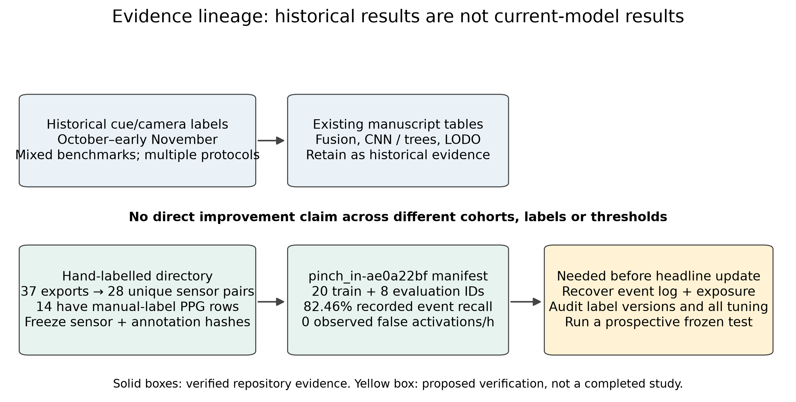

# Manuscript evidence audit: historical data versus hand-labelled development

**Audit date:** 7 November 2026. **Repository snapshot:** `504e693` (before these documentation additions). **Scope:** all four manuscript variants; checked-in recordings, models, experiment artifacts and relevant source. This is a provenance and reporting audit, not a new benchmark or a guarantee of Q2 acceptance.

## 1. Direct answer

**The concern is valid: the manuscripts mainly report older cue/camera-labelled experiments, and do not describe the newer `pinch_in-hand-labeled` model or its cohort.** The older results are not thereby invalid. They answer historical questions under different labels, preprocessing, cohorts and threshold-selection procedures. They must not be presented as measurements of the current hand-labelled detector.

The journal article already includes the November 5 curriculum, camera-label hold-gap audit and motion-normalisation investigation. It is therefore inaccurate to call the entire paper “October-only.” The missing distinction is between **historical experiments**, **later median-scaled models**, **the hand-labelled development model**, and **a future confirmatory test**.

No manuscript, label, sensor recording or trained model was rewritten by this audit. The per-folder guides provide proposed replacement text and insertion instructions. Scientific claims should be updated only against an explicit experiment identity, not by substituting a newer percentage into an old table.



*Figure A. Evidence lineage, not a performance comparison. Yellow items are verification work still needed. The current-model number is a stored manifest result, not a newly reproduced test.*

## 2. What the hand-labelled directory actually contains

Sources: [`audit_evidence.py`](revision-assets/audit_evidence.py), [`evidence-audit.json`](revision-assets/evidence-audit.json), [`hand-labelled-inventory.csv`](revision-assets/hand-labelled-inventory.csv).

A read-only scan of `data/recordings/Hand labeled/` found:

- **37 exported directories**, with **127.918 summed PPG minutes** before deduplication.
- **28 distinct PPG+IMU sensor-column hash pairs**, with **98.080 summed minutes** after retaining one representative of each identical pair. These are unique stream pairs, not necessarily independently collected human sessions or eligible negative exposure. Overlapping partial recordings would require an additional timestamp/identity audit.
- **Nine pairs of exports have identical saved sensor columns and timestamps despite different names.** Six pairs are `pinch_hold` / `pinch_in` exports from November 6; three are `supported` / `unlabeled` exports. See the JSON's `duplicate_sensor_groups` for exact IDs.
- **14 exports contain nonempty `manual_label` PPG rows**. Across all exports, **4,931 PPG rows have a different effective label from the original `label`**. Those are sampled rows, not 4,931 human edits or events.
- The scan finds 407 `pinch_in`, 395 `pinch_hold` and 408 `pinch_out` contiguous runs on the PPG rows **before deduplication**. These are not trainer-eligible starts, do not establish class balance in the training windows and must not be copied into the paper as evaluated-event denominators.

**Do not claim that all 37 exports were manually annotated.** Folder membership is insufficient. Some retain original labels; negative recordings need not have any explicit override. Conversely, absence of `manual_label` does not prove absence of human review: the audit cannot recover reviewer actions that were not saved as provenance.

### Label semantics to describe precisely

[`csv_io.py`](../../tools/label-trainer/src/label_trainer/csv_io.py) and [`test_manual_label.py`](../../tools/label-trainer/tests/test_manual_label.py) establish:

1. A nonempty `manual_label` overrides `label`.
2. A blank manual field falls back to the original label; it does **not** mean “reviewed negative.”
3. `-` overrides an original label to no label.
4. `left_out` is a named exclusion label, not automatically the same as `-`. Event evaluation ignores labels supplied in the experiment's exclusion set; the exclusion configuration must be preserved and checked. A CSV containing `left_out` alone does not prove every pipeline excluded it.
5. The exact historical experiment's loader matters: old standalone research scripts may read `label` directly instead of the current trainer's effective-label logic. Reusing an old script on edited CSVs can silently ignore the corrections.


*Figure B. Actual saved PPG and gyroscope samples from `gesture-dataset-pinch_hold-2026-11-03T01-05-59.434Z`, showing original versus effective row labels. Each PPG channel is centred and divided by its unscaled MAD over the displayed interval solely for visualisation; this is not the model's input normalisation. Gyroscope magnitude retains rad/s. Time is relative to the first saved PPG timestamp. No clock shift, interpolation, fitted prediction or invented waveform is shown. Manual corrections are not independently verified physical contact times.*

### Duplicate-aware split result

For the hand-labelled pinch-in manifest, **all 20 training and 8 evaluation IDs resolve to the scanned directory**, and **no identical PPG+IMU sensor pair crosses those roles**. Thus the discovered aliases are a real split hazard, but this audit does **not** find that particular leakage in that model.

The older median-model manifests use UUIDs that did not resolve through the scanned directory's available `recording.json` IDs. Their duplicate-aware split check is **incomplete**, not a pass. Recover the original import index / training-run inventory to join UUID → source stream hashes. The absence of an identical complete-stream hash also does not rule out overlapping crops or other participant/day leakage.

## 3. Checked-in models: what can and cannot be said

Every checked-in model's bytes matched its declared SHA-256 in this audit. Integrity is not accuracy validation, and the repository does not establish which model is active on a user's laptop.

| Bundle | Stored model identity | Stored event recall | Stored false activations/h | Evidence boundary |
|---|---|---:|---:|---|
| `pinch_in-hand-labeled` | `pinch_in-ae0a22bf`; median CNN | 0.824561 | 0 | 20 train / 8 evaluation IDs; training-selected threshold per metadata; no checked-in event log accompanying this bundle |
| `pinch_in-median` | `pinch_in-0ef9efc5`; median CNN | 0.877193 | 4.148943 | Different model; UUID cohort unresolved here |
| `pinch_out-median` | `pinch_out-4ba930b3`; median CNN | 0.830508 | 0 | Different target and model; UUID cohort unresolved here |
| `pinch_in-cnn` | `pinch_in-c0cb37c1`; rolling CNN | 0.438596 | 56.849691 | Earlier October-ID evaluation cohort; not hand-labelled current-model performance |
| `pinch_out-cnn` | `pinch_out-90d35e87`; rolling CNN | 0.290323 | 449.981430 | Earlier October-ID evaluation cohort; not the current paired interaction result |

These rows have **different cohorts and configurations**. Do not rank their accuracy or infer the gain from manual labels from this table. Window-level F1 and ROC AUC fields in the manifests are also not event precision/F1.

### The newer hand-labelled model

Verified source: [`pinch_in-hand-labeled/manifest.json`](../../trained-models/pinch_in-hand-labeled/manifest.json).

- SHA-256: `ae0a22bf8f744d5fa2fce9208221f0947288c5ba5c5eb196180985a70d77ba0d`.
- Preprocessing kind: `ppg_imu_cnn_median`; input dimension 450; context contract 11,000 ms.
- Activation 0.99; release 0.84; cooldown 1,500 ms; peak trigger; nominal decision delay 500 ms.
- Stored ROC AUC 0.981993, balanced accuracy 0.881720 and window F1 0.865854; stored **event** recall 0.824561 and observed event FAR 0/h.
- `thresholdSource = trainingRecordings`; `thresholdChosenOnEvaluationRecordings = false`. This is stronger metadata than the old curriculum's threshold-tuned validation pair, but does not establish that architecture, labels, exclusions or repeated model selection never used these evaluation recordings.
- Train/evaluation ID sets are disjoint. The evaluation includes three pinch-hold recordings, two still recordings, two supported recordings and one everyday-noise recording, classified here by their actual listed IDs; their semantic labels must still come from file contents, not names.
- Their summed PPG span is 1,922.033 seconds. **This is not eligible no-gesture exposure:** context warm-up, gaps, excluded spans and gesture/match windows can reduce it. Do not calculate an exact confidence bound using this total as the FAR denominator.

**Missing for a headline current-model claim:** eligible caught/total counts, emitted event timestamps, repeats/late/misses, eligible negative seconds, latency distribution, per-recording outcomes, threshold-selection log, precise annotation-version hashes and full training configuration. Do not reverse-engineer event counts from a rounded recall or borrow the 57-event denominator from another model.

> **Update, 8 November 2026:** the event log is now recovered. Replaying this bundle over its eight listed evaluation recordings with the trainer's own detection and event-accounting code reproduces the stored metrics exactly: 47/57 starts caught, 4 late, 0 repeats, 0 false activations over 1,735.4 s of eligible no-gesture time (95% upper bound 6.2/h), median latency 442 ms, and no interior input gaps. The everyday-noise session peaks at 0.970 against the 0.99 threshold. See [the replay report](revision-assets/HAND_LABELLED_REPLAY.md). It remains development evidence; the training configuration is reconstructed, and the threshold-selection log and annotation hashes are still missing.

There is no separately named `pinch_out-hand-labeled` bundle in this checkout. The median pinch-out bundle is not automatically the matching hand-labelled model; its cohort must first be resolved.

**Evaluator exposure risk to verify:** current `label_train.py:detections` sets observed time to the span from the first to last eligible decision and subtracts gesture/exclusion spans. It does not explicitly subtract every interior input-unavailable gap. If decisions disappear within that span, the reported negative-time exposure may include downtime. This is a code-path observation, not proof that a particular stored result contains such gaps. Recover decision-availability masks and audit denominators before making a continuous reliability claim; report downtime separately.

**Metadata inconsistency:** the hand-labelled and median manifests' `preprocessing.kind` says median, but their `provenance.pipeline` prose still describes rolling 10-second z-scoring. The paper must use the implemented preprocessing associated with the model contract. Correct the exporter and re-export metadata in a separately scoped implementation change; do not silently alter signed/hash-associated artifacts during a documentation audit.

## 4. Claim-by-claim manuscript disposition

The journal locations below refer to `ieee-journal/body.tex`; its Springer journal copy is identical. Search the quoted phrases in the shorter conference pair.

| Existing claim / location | Evidence found | Required treatment |
|---|---|---|
| Abstract: “about two thirds ... on unseen sessions” | Historical CNN/trees comparison and newer-day subsets; LODO selected row is 161/372 (43.3%), not two thirds overall | Specify cohort and operating point. Do not use an unqualified generalisation headline. |
| RQ2 / `tab:lodo`: 161/372; noise FAR 7/h; pinch FAR 49/h | [`cnn-all-days/results.md`](../research/artifacts/cnn-all-days-2026-11/results.md), “all moments, no still-hand gate” | Preserve as historical explored camera-label LODO. Show day-level catches and FAR separately. |
| LODO “earlier” row: 204/372 | Source explicitly says live model trained on most October sessions | Keep conspicuous non-independent caveat or remove from main generalisation comparison. |
| “final ... 15 of 20 and 18 of 21” | Exact current-model identity and event-log provenance not established by this audit | Mark provenance unresolved; do not attribute to `ae0a22bf`, median bundles or curriculum by similarity. Recover originating evaluation artifact or remove. |
| Worst-split AUC 0.789 → 0.837 | Historical frozen 37-recording, 1,390-event fusion experiment | Keep in history/ablation with its original label era. It is not a measured PPG contribution for the new hand-labelled CNN. |
| Curriculum: 15/19 and 10/19, FAR 0 | [`cnn-curriculum-old-noise`](../research/cnn-curriculum-old-noise-2026-11.md) and linked JSON | Correctly marked exploratory: same pair selected threshold and supplied outcome. Do not promote to independent testing or current hand-label evidence. |
| Motion-burst table: median scaling removes blind spot | [`cnn-motion-hangover`](../research/cnn-motion-hangover-2026-11.md) uses maximum score 0.1–1 s after starts for spliced-burst percentages | Call it a synthetic-splice **window-score sensitivity** check, separate from continuous event replay; not live robustness proof. |
| Equation: divide by MAD | [`cnn_input.py`](../../tools/label-trainer/src/label_trainer/cnn_input.py) uses 1.4826 × MAD plus channel floor and clipping | Replace equation and define shared-window indexing, floor and clip. Distinguish rolling and median variants. |
| “fires at the peak”; next detection waits 1.5 s | [`detection.rs`](../../crates/label-inference/src/detection.rs): first decline after above-threshold climb; cooldown after detection ends | State causal emission at first decline, not retrospective peak timestamp; report actual emitted-event latency. |
| Camera labels described as ground truth | Automatic landmarks, session-adaptive distance thresholds, later manual overrides | Use “reference annotations”; quantify mapping/boundary uncertainty and independent review. Manual edits are not automatically perfect ground truth. |
| “training and test recordings are always disjoint” | Hand model IDs and sensor hashes disjoint; some historical comparison rows explicitly reused training data | Scope statement per experiment. Group source-equivalent exports, not filenames alone; repeated development evaluation is not a sealed test. |
| 15-minute BLE log / 31 µs input building / native volume latency | Existing engineering claims, not remeasured here | Preserve as prior measurements only with hardware, build, method, raw log and distribution; do not describe as comprehensive deployment validation. |


*Figure C. Historical camera-label LODO for the selected no-still-hand-gate configuration. Catch counts: 21/171, 37/52, 67/92 and 36/57. Dashed line is pooled 161/372. The newer days support the narrower “roughly two thirds” description, not the aggregate. Rates and thresholds are inherited from the explored historical artifact; this is not a rerun on manual labels.*

## 5. Safe draft text for immediate correction

### Dataset/provenance paragraph

> We distinguish historical cue-labelled and automatically camera-labelled experiments from a later development cohort containing manual annotation overrides. In the latter, a nonempty manual field supersedes the original row label; blank manual fields retain the original annotation. Exported files that share identical sensor samples are grouped as one source recording rather than treated as independent sessions. Results are attributed to their exact model, cohort, annotation version and threshold-selection procedure; historical measurements are not relabelled as results of the newer model.

### Current-model paragraph — development evidence only

> The checked-in hand-labelled pinch-in bundle (`pinch_in-ae0a22bf`) records event recall of 0.8246 and no observed false activations on its listed evaluation recordings. Its manifest identifies 20 training and eight evaluation recording IDs, with threshold selection confined to training recordings. Our repository audit resolves these IDs and finds no identical complete sensor stream crossing those roles. However, the available bundle lacks the full event log, eligible negative exposure and latency distribution, and its evaluation recordings have not been established as untouched by all development decisions. We therefore treat these values as stored development evidence, not confirmatory performance or a comparison with earlier models.

### Historical-results correction

> In the explored camera-labelled leave-one-day-out study, the selected CNN configuration caught 161 of 372 starts (43.3%), with seven false activations per hour on noise recordings and 49 per hour of no-gesture time within pinch recordings. Performance varied substantially by held-out day: 21/171 and 37/52 starts on the October days, versus 67/92 and 36/57 on the November days. This variability limits any claim of general cross-day robustness.

### Normalisation correction

For each decision, let `G` be the causal 549-tick grid ending at that decision and `W` its final 50 ticks (50 Hz). The implementation uses:

```tex
\begin{align}
 m_c &= \operatorname{median}_{j\in G}(x_{c,j}),\\
 s_c &= 1.4826\,\operatorname{median}_{j\in G}|x_{c,j}-m_c|,\\
 u_{c,t} &= \sigma\!\left(\operatorname{clip}\!\left(
       \frac{x_{c,t}-m_c}{s_c+\epsilon_c},-500,500\right)\right),
       \quad t\in W .
\end{align}
```

The 549-tick grid spans 10.96 s from first to last sample, under an 11 s contract. Unlike the rolling variant, median scaling shares one centre/spread across the whole input grid at each decision; it is causal at the **decision**, not a separate past-only fit for every historical tick. Motion floors are 0.02 on accelerometer axes and 0.01 on gyroscope axes; the PPG floor is `0.001 × (abs(m_c) + 1)`. State units and the orientation of the flattened channel/time tensor. Do not apply the displayed Figure B normalisation to inference.

### Trigger correction

> After the score has reached the activation threshold, the causal peak trigger emits a detection on the first strictly decreasing score. The event timestamp is that decision time, not a backdated maximum. The detector remains active until the score falls below the release threshold; the cooldown is measured from that falling transition. Nominal training delay is distinguished from observed event and action latency.

## 6. Minimum provenance package before replacing the paper's headline results

- [ ] Recover the exact hand-labelled training run and its original dataset import inventory.
- [ ] Freeze one canonical source ID, sensor hashes, annotation hashes, reviewer/version history and role per recording. Group aliases and overlapping crops before splitting.
- [ ] Confirm effective labels and configured exclusions in both trainer and evaluator. Keep fist out of the current training cohort unless deliberately authorised; historical fist analyses may remain clearly identified.
- [ ] Recover and checksum per-recording event outcomes, predictions, negative seconds and latencies; verify the manifest metrics against them.
- [ ] Record every selection decision using the existing evaluation set. If it influenced development, call it validation/development evaluation, regardless of its filename.
- [ ] Resolve the pinch-out cohort separately. Report both targets, not only the stronger pinch-in result.
- [ ] Freeze code, model, thresholds, quality gates, matching tolerance, excluded intervals and inference cadence before collecting prospective data.
- [ ] Collect an untouched test and report all sessions, including failed/aborted ones and input-unavailable time.

See [Q2 research plan](Q2_RESEARCH_PLAN.md) for the proposed study and [the four per-format guides](README.md) for insertion locations. There is no universal experiment count or accuracy threshold that guarantees a Q2 publication.
