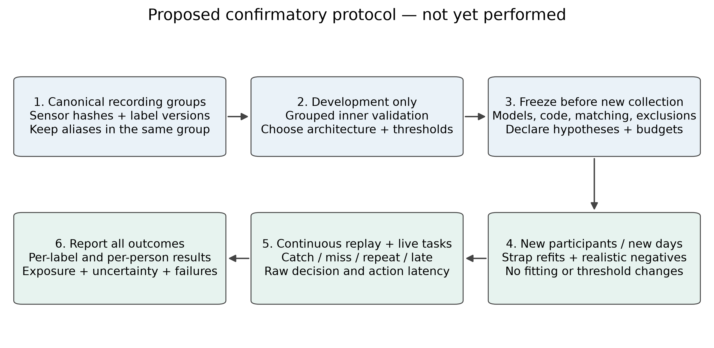

# Research and revision plan for a credible Q2-target submission

**Status:** proposed study plan plus verified repository inventory, 7 November 2026. No new training or human study was performed for this document. “Q2-target” describes an ambition, not an official grade of a paper or a promise of acceptance. Journal quartiles depend on database, category and year; verify a shortlisted venue's current classification separately.

Read [the evidence audit](EVIDENCE_AUDIT.md) first. Its distinction between old camera/cue experiments and the newer hand-labelled development model is mandatory throughout the revision.

## 1. Choose one coherent contribution

### Recommended primary claim

**A reproducible, failure-aware spatial interaction built from consumer head tracking and smartwatch PPG/IMU, evaluated continuously under annotation and cross-session uncertainty.**

The contribution should be the demonstrated relationship between data provenance, temporal detection, failure handling and real interaction quality—not merely connecting devices or replacing trees with a CNN. A compact architecture is adequate if the evaluation isolates why it works and when it fails.

Candidate research questions:

1. **RQ1 — Annotation:** How much do reviewed manual boundaries change event counts, timing uncertainty and detector outcomes relative to original camera annotations on the same source recordings?
2. **RQ2 — Modalities and normalisation:** Under identical recordings, splits and operating-point selection, what does PPG add beyond IMU, and does robust normalisation reduce recovery time after real movement?
3. **RQ3 — Generalisation:** How does a frozen per-user model perform on new days and strap refits? If claiming user independence, how does it perform on unseen participants without calibration?
4. **RQ4 — Interaction:** Does look–pinch–turn enable reliable target-volume control, and do fail-closed policies prevent unintended actions during ordinary activity and injected faults?

The current article asks some of these questions but mixes several data eras in its answers. Make the main evaluation one frozen protocol; put exploratory history in a short motivation section or supplement.

## 2. What is already implemented or measured

The following is **repository evidence**, not a fresh end-to-end validation on all platforms. Do not rebuild these features just to make the paper look larger.

| Existing capability | Evidence home | What the paper can use | Remaining scientific gap |
|---|---|---|---|
| Consumer Sony head orientation, calibration and dwell | [components](../architecture/components-and-deployment.md); `crates/head-tracking`, `crates/interaction-engine` | Actual sensing/topology and target selection | Target-selection error, drift/recalibration frequency, selection time across users |
| Watch-only sensing; desktop training, inference and actions | [components](../architecture/components-and-deployment.md) | Clear placement of compute; neither camera nor on-watch inference is required at deployment | Measure CPU/memory, warm-up, energy and action latency in a fixed build |
| BLE/Wi-Fi paths, batching, ordering and watch timestamps | [BLE protocol](../protocols/watch-ble-transport.md); [WebSocket protocol](../protocols/watch-websocket-protocol.md) | Transport constraints and loss handling | Long-run p50/p95/p99 age, gaps, reconnect recovery and watch battery measurement |
| Saved camera landmarks and time correspondence | [camera-label audit](../research/camera-label-hold-audit-2026-11.md) | Explain reference-label production without claiming continuous image storage | Residual sync uncertainty; missed/occluded contact; independent boundary review |
| Manual annotation overrides and Labelling interface | [manual-label tests](../../tools/label-trainer/tests/test_manual_label.py); `apps/desktop/src/features/labelling` | A reproducible correction pipeline with original labels retained | Reviewer protocol, inter-rater agreement and versioned annotation manifest |
| Binary per-label trees/CNNs, median and rolling input variants | `tools/label-trainer/src/label_trainer`; `crates/label-inference` | Existing baselines and deployable input contract | Matched manual-label ablations; both targets on independent data |
| Continuous event replay and temporal trigger | [metric standard](../research/gesture-detector-evaluation-metrics.md); `label_train.py`; `detection.rs` | Catch/repeat/late/false taxonomy; explicit negative-time denominator | Recover current model's event logs and expose unavailable time as a separate result |
| Model hashes, load-contract checks, Off/Monitor/Live modes | [fail-closed architecture](../architecture/safety-and-fail-closed-behavior.md) | Safety design and reproducible artifacts | Live fault-injection outcome rates, not an assertion of formal safety certification |
| Paired grab/release, bounded wrist mapping and native volume writer | `crates/interaction-engine`; `crates/volume-control` | Real interaction rather than a gesture-only demo | Controlled user task with completion/error/fatigue measures |
| Historical fusion, trigger, curriculum and motion-burst studies | [research notes](../research/ppg-imu-fusion-and-triggers-2026-10.md), [curriculum](../research/cnn-curriculum-old-noise-2026-11.md), [hangover](../research/cnn-motion-hangover-2026-11.md) | Motivation, failure analysis and candidate hypotheses | Not automatically evidence for the latest annotation version |

The repository now also contains drone work. **Do not add it to this article**: it introduces unrelated claims and safety requirements. Keep the laptop interaction scope coherent.

## 3. Relevant literature actually retrieved for this audit

This was a focused search of the project's related-work trail, not an exhaustive systematic review. Full text was retrieved for sources 1–4 and 7 below; Crossref metadata only for sources 5–6. Do not use a DOI metadata record as evidence for an uninspected experimental result. Retrieval details are in [source ledger](revision-assets/literature-sources.json).

1. **Bonazzi et al., OpenWatch: A Multimodal Benchmark for Hand Gesture Recognition on Smartwatches**, arXiv `2605.04791v2`: [primary full text](https://arxiv.org/html/2605.04791v2). Reports over 10 hours, 50 participants, 59 labelled gesture sequences, subject-independent evaluation and modality ablations. Its reported PPG benefit of 12.5 F1 points concerns foundation smartwatch models; it is not a universal gain for every architecture. **Implication:** “PPG + IMU works” is not sufficient novelty. Contrast continuous command detection and false-action exposure with its sequence-classification setting. Verify data/channel/window compatibility before proposing transfer, and describe it as a preprint unless a final venue is independently established.
2. **Chen et al., Robust Finger Interactions with COTS Smartwatches via Unsupervised Siamese Adaptation (ViWatch)**: [author-hosted primary PDF](https://www.cs.virginia.edu/~stankovic/psfiles/ViWatch_UIST_%20FINAL.pdf). **Implication:** adaptation is established related work. Distinguish frozen cross-day transfer from calibration/adaptation and do not compare its recognition percentages directly with this project's continuous recall at a false-alarm budget. Its method is not simply “train our CNN longer.”
3. **Tsunoda, Choi and Shizuki, Thumb-to-Finger Gesture Recognition Using COTS Smartwatch Accelerometers**: [author-hosted primary PDF](https://www.iplab.cs.tsukuba.ac.jp/paper/international/tsunoda_MUM2024.pdf). Its abstract reports 94.7% for four gestures in leave-one-participant-out CV and 90.2% for 11 gestures in participant-specific leave-one-session-out CV; the study recruited 12 participants. **Implication:** an IMU-only comparator and an explicit participant/session generalisation target are necessary. These accuracies are not directly comparable with continuous pinch event recall.
4. **Ruan et al., Principal component analysis of photoplethysmography signals for improved gesture recognition**, Frontiers in Neuroscience: [primary full text](https://www.frontiersin.org/journals/neuroscience/articles/10.3389/fnins.2022.1047070/full), DOI `10.3389/fnins.2022.1047070`. Uses 14 subjects, three optical wavelengths, four activity states and SVM/KNN comparisons. **Implication:** evaluate activity and wavelength effects explicitly; cropped/classification accuracy is not evidence for low all-day false activations. Any fitted PCA must be learned on development data only; do not add a noncausal transformation to a causal runtime unacknowledged.
5. **Fang et al., Exploration on the Negative Effects of Sensor Shifts in Photoplethysmography-Based Gesture Recognition and a Solution Based on Transfer Learning**, DOI `10.1109/TIM.2023.3268469`: [metadata checked](https://api.crossref.org/works/10.1109/TIM.2023.3268469). **Implication:** sensor-shift novelty must be positioned against existing transfer-learning research; full-text verification is still required before quantitative comparison.
6. **Zhang et al., FinDroidHR**, DOI `10.1145/3191788`: [metadata checked](https://api.crossref.org/works/10.1145/3191788). **Implication:** smartwatch optical gesture input is longstanding prior work. Complete the manuscript's authors/title/subtitle from authoritative publisher metadata; no new performance claim is inferred here.
7. **scikit-learn, Common pitfalls and recommended practices**: [official guidance](https://scikit-learn.org/stable/common_pitfalls.html). Supports isolating test data from model/preprocessing choices. This is methodological documentation, not evidence for wearable accuracy or a journal-tier requirement.

### Related-work table to add

For each directly relevant paper, extract: participant count, watch/custom hardware, sensing channels/rates, target gestures, prompted versus continuous activity, reference-label method, participant/session/day split, permitted calibration, model and deployment location, metric and negative exposure. Use `not reported` where appropriate. Include an explicit “not directly comparable” column when protocol or target differs. Do not create a leaderboard by mixing accuracy, window F1, AUC and continuous event recall.

## 4. Study A — Repair annotation provenance before model comparison

### Completed foundation

Original labels and overrides are saved separately; sensor-column hashes identify repeated exports. The audit found no full-stream alias crossing for the resolved hand-labelled pinch-in train/evaluation roles. That is a useful reproducibility result, not proof that manual labels are correct.

### Proposed experiment

- Preserve original sensor bytes. Version annotations independently with original source ID, annotator, timestamp, guidance version, edit rationale and content hash.
- Define pinch-in physically (e.g. first visible contact), pinch-hold and pinch-out (e.g. first visible separation); specify camera frame uncertainty, occlusion and unresolvable cases. Do not equate a delayed optical peak with contact/release.
- Have an independent reviewer label a prespecified stratified sample, including no-hold cases, short events, motion and disagreements. Blind the reviewer to detector outputs and the model under comparison where feasible.
- Report event agreement and matched-boundary absolute errors (median, IQR, p95). A time-weighted agreement statistic can supplement them, but background dominance makes a single kappa insufficient.
- Compare original versus reviewed annotations on identical source recordings, with disagreements adjudicated before the confirmatory test. Do not move labels to maximise a model's score.
- Treat `left_out` explicitly: reasons, durations, distribution across conditions and excluded detections. Report usable recording coverage; hiding hard negatives through exclusions can inflate results.
- Isolate two effects: (a) **rescore the same frozen predictions** under original/reviewed references (measurement effect); (b) **train matched models** under each label version using the same grouped split (learning effect). Never call their sum a single causal improvement without this separation.

**Deliverables needed:** versioned canonical cohort CSV/JSON, per-stream and annotation hashes, annotator protocol, disagreement summary and event-level audit trail. The audit's PPG-run counts are descriptive and cannot replace trainer-derived denominators.

## 5. Study B — Minimum model ablations worth running

Use the same source groups, model-capacity budget, seed list, input cadence, match window and threshold-selection procedure. Thresholds can differ by model if selected on the same development protocol to the same prespecified false-activation objective; do not retune on test data.

**Core matrix, rather than another architecture sweep:**

- IMU only, PPG only, and fused IMU+PPG, all on the reviewed annotation version. Keep accelerometer and gyroscope ablations if needed to locate the useful modality.
- Existing compact CNN versus the existing engineered-feature ExtraTrees baseline. State differences in history and nominal decision delay rather than pretending the representations are identical.
- Rolling normalisation versus median/MAD normalisation at comparable development-selected operating points. Report full recall–FAR curves and fixed-operating-point test results; one convenient threshold is insufficient.
- Original camera labels versus reviewed overrides using the paired design in Study A.
- For the interaction: start detector alone versus paired start/release policy, measuring both missed releases and unintended commands. Do not train a new hold classifier unless the question actually needs one.

Report both pinch directions separately and per recording/day/person. Give caught/eligible counts, misses, repeats, late events, false activations, eligible negative duration, event precision/F1 with an explicit treatment of repeats/late, latency quantiles and input-availability coverage. Keep window ROC AUC, PR AUC and calibration as secondary diagnostics.

**Do not prioritise:** a larger transformer, new reinforcement learning, extra modalities, an on-watch port or an unrelated drone study. The current barrier is validation and contribution clarity, not architecture size.

## 6. Study C — Prospective generalisation

*Proposed protocol; none of these new data-collection stages has been completed by this documentation task.*

Choose a deployment claim before choosing the split:

- **Personalised daily use:** train/calibrate per person, then test that person's model on new days/refits with no test adjustment. This is not user-independent recognition.
- **User-independent use:** outer holdout is the whole participant; all fitting, thresholds and learned transforms stay inside development participants. Add day/refit variation within the held-out users.
- **Few-shot adaptation:** explicitly separate a new person's calibration block from their later test blocks; report calibration time and samples as a cost.

For planning, a **12–20-participant feasibility study across at least three sessions/days per person** is a reasonable starting discussion, not a Q2 rule or a justified final sample size. Size the actual study from pilot between-person variation, paired-effect precision and feasible negative exposure; preregister stopping and missing-data rules. If only one person can be studied, frame the work as a longitudinal personalised case study and narrow claims substantially.

Include prespecified quiet and everyday activities, typing/mouse/trackpad use, walking, wrist turns, supported/resting/free arm and strap removal/refit. Keep moving-hand pinches as a separate out-of-scope stress condition if the intended interaction explicitly requires a still hand. Record actual sample rates, dropped data, watch fit, handedness and device version. Do not claim skin-tone or population generalisation without appropriate sampling and consent.

Freeze model binaries/hashes, code commit, label protocol, matching rules, thresholds, quality gates and user instructions **before** prospective collection. Keep an untouched test uninspected until the single planned analysis. Any iteration creates a new development set and requires a new confirmatory test.

### False activations and uncertainty

- Report false-event counts and eligible hours, not just rounded `0/h`.
- Under a constant-rate Poisson model, zero events in `T` hours gives one-sided 95% upper rate `-ln(0.05)/T`. State that correlated activities and participants may violate the constant-rate assumption.
- Choose exposure for the intended claim: approximately three zero-event hours are needed merely to bound the rate below one/hour under that model. Thirty to sixty minutes per session is useful coverage but does not establish all-day reliability or replace varied conditions.
- Use participant-level resampling for participant generalisation and session-level resampling for a personalised repeated-session study; avoid pretending overlapping windows are independent observations. Report paired differences with intervals, and list seeds without treating them as extra participants.
- Separate detection latency from end-to-end command latency. Log sensing, receipt, eligible decision, emitted event, policy acceptance and completed volume write on mapped clocks. Include clock-mapping uncertainty.

## 7. Study D — Demonstrate the actual interaction

The existing prototype is a strength only if evaluated as an interaction.

Proposed within-participant task: reach randomly assigned volume targets from specified start levels using (1) look–pinch–turn and (2) a conventional volume control. A wrist-only or button-armed variant can be an additional ablation if it answers the value of head targeting. Counterbalance order, provide equal practice and report task/participant exclusions.

Measure completion time, final absolute volume error, overshoot, retries, missed grab/release, unintended actions and recovery. Include an explicit completion criterion and timeout. Record workload/usability using a justified established questionnaire, plus discomfort/accessibility observations. This is not proof of an accessibility benefit without studying the intended population.

For **Midas-touch/fault testing**, replay or inject head exit, stale PPG, stale orientation, disconnect, reconnect, wrong device identity, model switch, Off/Monitor transition and an outstanding writer target during release. Measure cancellations, residual writes and time to safe state, with a fixed pass criterion. Software tests establish code behaviour in their fixtures; physical trials establish behaviour of the deployed setup. Report both without calling either a formal safety guarantee.

For systems efficiency, record device/OS/build, CPU and memory, input-building and inference latency distributions, BLE gaps and battery drain over measured exposure. Existing 31 µs preprocessing or 15-minute transport observations are narrow prior measurements, not substitutes for this experiment.

## 8. Figure and table plan

### Available now, with honest captions

1. **Evidence lineage** — separate historical, hand-labelled and future evidence. Use in revision notes or a shortened methods provenance figure.
2. **Real telemetry + annotation revision** — [PNG](revision-assets/annotation-telemetry.png), [vector PDF](revision-assets/annotation-telemetry.pdf), [SVG](revision-assets/annotation-telemetry.svg). Include the precise session and normalisation caption from the audit. Do not label it model output.
3. **Historical day-transfer plot** — shows the limitation obscured by the aggregate headline; place with historical results.
4. **Prospective protocol diagram** — label as proposed until actually executed. It belongs in future work or a study protocol, not a completed Methods section prematurely.

All four have PNG/PDF/SVG exports, an editable generator and [figure provenance](revision-assets/figure-provenance.json). Generate new figures from saved real event logs when those exist.

### Still needed; do not draw fictional results

- Current model's per-person/day **recall–FAR curves**, with training-selected operating points and fixed test evaluation.
- **Prediction timeline** with reference intervals, score, emitted rising/falling events, threshold and eligibility mask; choose examples using a declared typical/failure criterion, not only attractive successes.
- **Annotation-boundary disagreement plot** and paired annotation/model-effect plot.
- **Real post-motion recovery** plot with burst duration, delay-to-pinch, eligible exposure and uncertainty, separate from synthetic splicing.
- **Interaction outcome plot** for time/error/unintended actions and an end-to-end latency decomposition.
- Tables: canonical dataset roles and hashes; matched baselines/ablations; per-condition outcomes; transport/fault trials; related-work comparability.

## 9. Paper-ready text, with evidence boundaries

### Contribution paragraph safe to use now

> This work studies a desktop-executed spatial interaction that combines head-directed target selection with smartwatch pinch detection and wrist rotation. The system contribution is a reproducible sensing-to-action path with bounded state transitions and explicit failure handling. We separate historical exploratory experiments from later manually revised annotations, and evaluate claims at the level of continuous events rather than relying on classification scores alone. The present evidence is primarily a single-participant development record; broader usability and generalisation remain to be established prospectively.

### Manual-label methods paragraph safe to use now

> Sensor samples retain their recorded timestamps, while annotation changes are represented separately from the original labels. During loading, nonempty manual annotations take precedence; an empty manual field retains the original label. We audit source-equivalent exports using hashes of non-label sensor columns and group them before assigning data roles. Manually reviewed annotations are treated as reference measurements with potential timing error, not as error-free physical ground truth.

### Future-study paragraph — retain future tense until completed

> A confirmatory study will freeze the detector, normalisation, thresholds and event-matching rules before collecting new participant and day-level sessions. Personalised and user-independent evaluations will be reported separately. Continuous negative exposure, event errors, input availability and emitted-command latency will be measured alongside task completion and unintended actions. No prospective test recording will be used for threshold selection or model revision.

### Results template — not a publishable result until filled from artifacts

> On the prespecified [participant/day] holdout, model [ID and hash] caught [k]/[n] eligible pinch-in starts and [k]/[n] pinch-out starts. It emitted [f] false activations over [T] hours of eligible no-gesture exposure, with [coverage]% input availability. Median and p95 event latencies were [values], measured at the causal event-emission timestamp. The thresholds were fixed using [development protocol] before test collection. Per-participant and per-day outcomes, confidence intervals and failures are reported in [table/figure].

Bracketed fields are deliberately missing; do not fill them from different experiments, infer them from rounded rates or leave the template in a submitted abstract.

## 10. Priority and acceptance checklist

### P0 — Correct now, before claiming current performance

- [ ] Separate historical/current/prospective evidence throughout title, abstract, methods, tables and conclusion.
- [ ] Remove or trace the unqualified two-thirds and untraceable “final 15/20, 18/21” claims.
- [ ] Document manual override semantics, source aliases and the actual cohort; correct equation and causal trigger wording.
- [ ] Label the burst table as a window-score splice diagnostic, not live continuous recall.
- [ ] Complete all bibliography metadata, affiliation, ethics, consent, funding and artifact-access statements from verified facts.

### P1 — Main scientific work

- [ ] Recover/reproduce the current hand-labelled event logs and the pinch-out cohort.
- [ ] Audit labels independently and run the minimum matched modality/normalisation/baseline comparisons.
- [ ] Collect a frozen prospective study sized for the declared claim and report uncertainty, exposure and failures.

### P2 — Strengthen the systems/HCI contribution

- [ ] Conduct counterbalanced interaction tasks and real fault/transport trials.
- [ ] Publish the allowable annotation/experiment artifacts, exact code/model versions and one-command reproduction instructions; physiological data require explicit access/privacy decisions.
- [ ] Choose venue and article type, then adapt page budget and contribution emphasis. An IEEE/Springer template is not a venue and supplies no evidence of quartile suitability.

**Submission gate:** a reader can trace every headline number to one immutable model, annotation version, source-group split and result artifact; the strongest claims match the weakest evaluated condition; at least one central contribution is tested prospectively rather than selected retrospectively. These are defensible research standards, not a formula guaranteeing Q2 acceptance.
