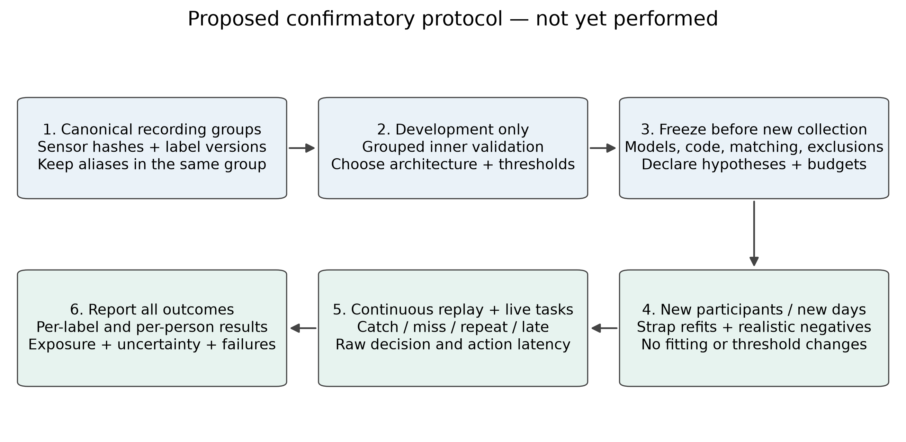

# IEEE journal manuscript: detailed Q2-target revision guide

**Applies to:** `main.tex`, `body.tex`, `refs.bib`, current eight-page PDF. This is an improvement specification with suggested insertion text and real figures, not an acceptance prediction. IEEE Transactions formatting does not make a paper Q1/Q2; select a specific journal and verify its category/year and author rules.

**Read with:** [evidence/provenance audit](../../EVIDENCE_AUDIT.md), [research plan and verified related work](../../Q2_RESEARCH_PLAN.md), [Springer journal counterpart](../springer-journal/IMPROVEMENTS.md). The journal body files currently match and should remain scientifically identical when edited.

## 1. Overall assessment and reframing

The draft has a useful systems contribution: stock head tracking and watch sensing, desktop inference, paired spatial interaction, continuous event evaluation and failure handling. It also records informative negative findings. Its main weaknesses are mixed data eras, insufficient current-model provenance, one-participant validation and no controlled interaction study.

A defensible Q2-target revision should answer a coherent set of questions rather than accumulate more experiments. The shared plan defines annotation effects, modality/normalisation contributions, prospective transfer and interaction quality. Do not imply that correcting prose alone supplies the missing evidence.

## 2. Section-by-section changes

### `main.tex`: title, abstract, keywords

The present title is reasonable for a systems article. If a stronger scientific focus is desired, an optional title is **“Failure-Aware Spatial Interaction with Consumer Head Tracking and Smartwatch Pinch Sensing.”** Do not use “robust,” “user-independent” or “real-world reliable” unless the new study supports them.

Remove the unqualified two-thirds headline and the implication that all displayed results describe one final detector. Suggested abstract replacement, suitable **before** new experiments:

> We present a laptop-control system combining consumer-headset orientation, smartwatch motion and photoplethysmography, and desktop-executed pinch inference. Head direction selects a target, paired pinch detections delimit a grab, and wrist rotation adjusts volume behind explicit fail-closed policies. Historical exploratory experiments exposed cross-day transfer failures, annotation uncertainty and a motion-induced normalisation blind spot. We distinguish these studies from a later manually revised development cohort rather than reporting their metrics as a single final-model result. The current evidence supports a single-participant systems study; prospective multi-day and multi-participant evaluation remains necessary to establish generalisation and interaction reliability.

After a confirmatory study, replace the last two sentences with its exact population, caught/eligible counts, negative exposure, latency and one primary comparative result. Do not retain a future-study abstract for a paper claiming that study as completed.

### Introduction and related work

State three concrete contributions: (1) integrated causal sensing-to-action design, (2) auditable annotation/event-evaluation methodology, (3) measured effect of specific design choices. Contribution 3 must be scoped to the actual old/new cohort until matched current experiments exist.

Add a related-work matrix following [the research plan](../../Q2_RESEARCH_PLAN.md#related-work-table-to-add). OpenWatch already addresses multimodal smartwatch learning across 50 people; ViWatch and Tsunoda address finger interaction/adaptation and IMU-only recognition. Novelty cannot simply be PPG+IMU fusion or a CNN. The defensible difference is continuous command operation, source/annotation provenance, recovery after movement and demonstrated interaction/failure behaviour.

### System design

Keep head calibration, paired release and bounded control; reduce incidental implementation inventory. Explain which checks reject a candidate and which force-release an already held interaction. Separate acquisition clocks from desktop freshness clocks. The camera is for annotation, not required at runtime; all inference remains on the laptop.

Add a compact state-transition figure or table for idle → target-ready → grabbed → released/cancelled. Use actual `gesture_policy` behaviour, including simultaneous release precedence. Do not invent a new state machine for the paper. Later add measured fault outcomes alongside the architectural claims.

### Data Collection and Ground Truth (`sec:data`)

Rename “ground truth” to **reference annotations and timing uncertainty** unless independently validated contact timing is available. Replace the current era table with a canonical cohort table and annotation-version policy.

Proposed insertion:

> We distinguish original cue annotations, automatic camera-derived boundaries and later manual overrides. Nonempty manual labels supersede original row labels; blank manual fields retain them. The current directory contains 37 exports but 28 distinct complete sensor-stream pairs, so export count is not an independent-session count. Source-equivalent streams are grouped before splitting. Fourteen exports contain explicit PPG overrides; this does not establish that every export was manually reviewed. Reference timing remains subject to camera visibility, clock mapping and reviewer uncertainty.

Do not use the 407/395/408 sampled PPG runs as evaluated-event denominators: they include duplicate exports and ignore trainer eligibility. Add source IDs, sensor/annotation hashes, participants/days, actual rates, label/exclusion coverage and role per experiment. Specify whether hand changes were based on landmarks, signals or both; avoid detector-informed boundary selection in the confirmatory reference set.

### Detection Methods (`sec:methods`)

Apply the exact [normalisation/trigger corrections](../../EVIDENCE_AUDIT.md#normalisation-correction). Define 549-tick decision grid, final 50-tick tensor, 1.4826 MAD scaling, per-channel floors, clipping and missing-input behaviour. Explain the old rolling variant separately rather than describing every result as median-scaled.

Document model ID/hash and versioned full training configuration. The hand-labelled manifest's preprocessing contract says median while its descriptive pipeline prose says rolling; report the inconsistency and repair the exporter separately. Do not silently edit an old bundle to appear consistent with the paper.

### Evaluation Protocol (`sec:protocol`)

Replace the blanket assertion that training and test are always disjoint with an experiment-specific role table. Some historical rows explicitly reused trained-on October sessions. State both file/source-group independence and whether evaluation influenced any selection.

Add definitions for:

- Eligible start, causal match window, one-to-one matching, repeat and late detection.
- Exclusion labels and their configured effect; `left_out` is not automatically ignored by every script.
- Warm-up, stale/gapped/quality-rejected data and **input-unavailable fraction**.
- FAR denominator as eligible no-gesture hours, not total recording span.
- Development versus confirmatory test; inner grouped threshold selection; subject/day generalisation target.
- Participant/session-cluster uncertainty and per-condition reporting; no window-level pseudo-replication.
- Separate sensor→decision, emitted-event and action-completion latency, including clock uncertainty.

### Results (`sec:results`)

Reorder:

1. **Current hand-labelled development result** with its evidence limitations, once full event artifacts are recovered.
2. Matched current-label modality/baseline/normalisation ablations, once run.
3. Prospective generalisation and interaction results, once collected.
4. Short historical development/failure analysis; put the extensive mixed-era robustness screen and rejected variations in a supplement.

Safe current-model text now:

> The repository's `pinch_in-ae0a22bf` bundle records event recall of 0.8246 and zero observed false activations/h for eight listed evaluation recordings, with the threshold selected on training recordings according to its metadata. The audit resolves all 20 training and eight evaluation IDs and finds no identical complete stream crossing those roles. These stored results are not a newly reproduced test; complete event logs, eligible negative exposure and latency are missing from the bundle, and independence from all development choices has not been established.

Do not use the older median pinch-out bundle as its matched counterpart without resolving UUID provenance. Do not borrow counts/latencies from the 15/19 curriculum or the 50/57 motion study.

For historical LODO, report 161/372 = 43.3% and the day-level breakdown. The 204/372 “earlier” model row is not an independent October holdout. Recover or remove “final 15/20 and 18/21.” Rename the burst table to a **synthetic-splice window-score diagnostic**, noting that it checks a maximum score in 0.1–1 s, not the continuous trigger or live event recall.

### Discussion, future work and conclusion

Discuss annotation-induced measurement changes separately from model improvements. PPG's contribution must come from a matched current-cohort modality ablation. Report the weak day/condition rather than allowing pooled numbers to conceal it. Treat zero observed false activations as an exposure-limited observation.

Proposed limitations insertion:

> Recording-disjoint evaluation is necessary but insufficient for an independent test when the same participants, label corrections or outcomes repeatedly inform development. Our source-hash audit addresses identical exports but cannot by itself rule out overlapping crops or selection bias. The current evidence is primarily from one participant and limited activity exposure. Neither manual labels nor synthetic motion splicing establish physical contact timing or everyday reliability. Conclusions are therefore scoped to the measured prototype and cohorts.

## 3. Figures to insert and what they establish


**Add near data/reference labels.** Use the caption in the audit, including exact session, watch-clock origin and visual-only normalisation. This is real telemetry with saved label changes, not a successful-detection illustration.


**Add near historical results or supplement.** Explicitly label it old explored camera-label evidence. It corrects the headline's hidden day variation without pretending to evaluate the newer model.



**Use in study planning/future work only until executed.** Once performed, replace “proposed” with the actual frozen roles and counts, not an idealised protocol that differs from the run.

IEEE insertion example:

```tex
\begin{figure*}[t]
  \centering
  \includegraphics[width=0.95\textwidth]{../revision-assets/annotation-telemetry.pdf}
  \caption{Observed telemetry and saved original/effective annotations.
  PPG uses displayed-window median/MAD units for visibility only;
  gyroscope magnitude is in rad/s. No model prediction is shown.}
  \label{fig:manual-annotation-audit}
\end{figure*}
```

Use vector PDF for print and PNG for Markdown/Joplin. Copy selected assets into this folder before standalone Overleaf upload. Check two-column text sizes and avoid adding all four audit figures to the main paper: a journal needs outcome figures, not mostly editorial diagrams.

**Still missing:** current-model score/event timeline, annotation disagreement plot, matched recall–FAR curves, real-motion recovery and live task/failure plots. Generate these only from measured artifacts; the shared plan defines the source fields required.

## 4. Research needed before a stronger journal claim

P0: resolve current event logs and pinch-out roles, freeze annotation versions, correct inherited claims. P1: matched ablations and prospective day/refit test; a participant study if claiming cross-person generality. P2: counterbalanced interaction study, live fault trials and transport/energy/latency measurements. Full designs, exposure uncertainty and proposed sample-size reasoning are in [Q2_RESEARCH_PLAN.md](../../Q2_RESEARCH_PLAN.md).

## 5. Final checklist

- [ ] Both journal bodies identical; wrapper abstracts both corrected.
- [ ] Every metric maps to one immutable model, cohort, label version and selection procedure.
- [ ] Current hand-labelled data are not conflated with old cue/camera benchmarks.
- [ ] No invented event counts, latency, negative exposure or future-study outcomes.
- [ ] Bibliography placeholders and VERIFY comments resolved against primary metadata/full text.
- [ ] Affiliation, biography, funding, ethics/consent, conflicts and availability statements factual and complete.
- [ ] Target journal scope, article length, current quartile/category and prior-conference-extension policy checked.
- [ ] Rebuild with `latexmk -pdf main.tex` after actual manuscript edits; inspect floats, equation breaks and citations.
