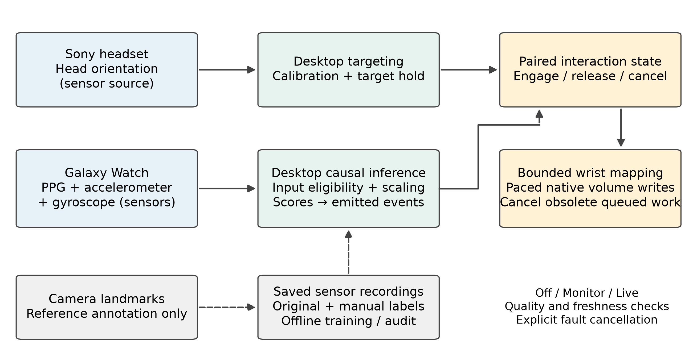
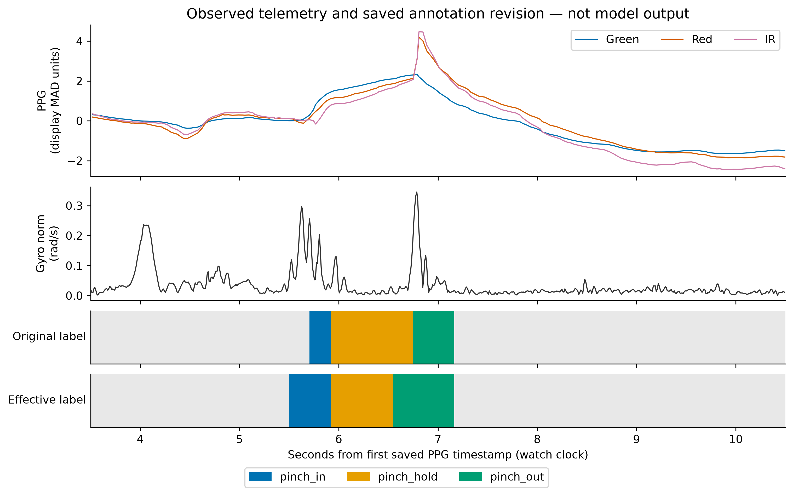
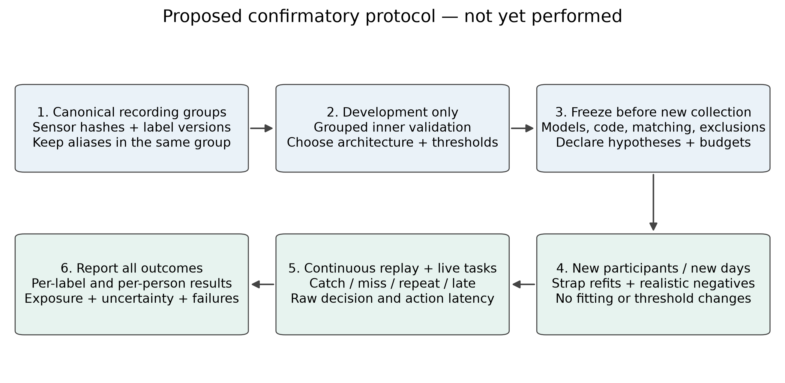

> **Working manuscript — author review pending.** This article reports an implemented system, historical exploratory experiments and a source-level audit of later hand-labelled development artifacts. It does not report a newly conducted participant study or a prospective test. IEEE and Springer copies contain the same scientific text.

# Abstract

Consumer headsets and smartwatches offer a route to touch-free laptop interaction, but a useful interface requires more than high classification accuracy on isolated gestures. We describe a spatial volume-control system in which head orientation selects a target, separate smartwatch pinch-start and pinch-release detections delimit a grab, and wrist rotation adjusts a bounded output. Photoplethysmography and inertial signals are processed on the laptop, while explicit cancellation and mode policies constrain actuation. We present a source-audited account that separates historical camera-labelled experiments from a later manually revised development cohort. The latter directory contains 37 exports but only 28 distinct complete PPG–IMU stream pairs; 14 exports contain explicit optical-sample annotation overrides. A stored pinch-in model reports 82.46% event recall and no observed false activations on eight listed evaluation recordings, but missing event logs and eligible exposure prevent independent reconstruction of these outcomes. Historical camera-label evaluation instead caught 161 of 372 starts in the selected leave-one-day-out configuration, revealing marked day variation. These results establish a reproducible prototype and expose the importance of annotation provenance, source-group isolation and causal event accounting; they do not establish population-level or all-day reliability. We specify the prospective, matched-modality and interaction evaluations required to test those stronger claims.

**Keywords:** smartwatch; photoplethysmography; inertial sensing; spatial interaction; continuous gesture detection; annotation provenance; reproducibility.

# Introduction

A person listening to audio while working may want to adjust laptop volume without reaching for a keyboard, mouse or small watch display. A wearable interaction can separate selection from manipulation: look towards a calibrated target, pinch to engage it, rotate the wrist to change a value, and release the pinch interaction. The hardware can remain commercially available, but interpreting finger activity from sensors at the wrist is indirect. Motion associated with a pinch competes with everyday movement, optical measurements vary with contact and placement, and an erroneous event can become an unintended command.

The problem is therefore continuous interaction, not merely discrimination between preselected gesture crops. A useful evaluation must account for missed starts, delayed events, repeated firings, false activations during ordinary activity and the conditions under which sensing is unavailable. A high window-level area under the receiver-operating-characteristic curve does not by itself establish a low command error rate. Similarly, a held-out filename does not establish an independent recording when the same sensor stream has been exported under several names.

This article describes the implemented Gesture Controls system and examines its evidence through a reproducible artifact audit [@repository]. Its current annotation workflow includes manually revised datasets, whereas several inherited experiments use cue or automatic camera labels. Rather than combine these into one apparent final-model result, we identify their different roles. The study is primarily a single-participant development record; no new human-subject experiment or detector training was performed for this manuscript.

The contributions are threefold. First, we describe a sensing-to-action design combining consumer head orientation, desktop smartwatch inference and a paired interaction policy with bounded output. Second, we provide a source-level audit of annotation semantics, duplicate exports, model identities and evaluation-role resolution. Third, we reinterpret historical and stored development outcomes under their actual evidence limits and formulate a confirmatory protocol. The contribution is not a new claim that multimodal smartwatch sensing or convolutional classification is intrinsically novel.

We address three questions: **RQ1**, how can the sensing and interaction path separate gesture events from sustained control and cancellation? **RQ2**, what does the available artifact record support about the manually revised detector, and where does its provenance remain incomplete? **RQ3**, which failures and evaluation decisions constrain stronger claims of transfer and everyday reliability?

# Related Work and Evaluation Context

## Wrist-based finger recognition

Optical smartwatch input predates this system. FinDroidHR demonstrates an established research direction for smartwatch gesture input [@findroidhr]. Its existence makes a broad claim of novelty for wrist optical gesture sensing inappropriate. Our focus is the continuous deployment and evidence-accounting problem rather than a claim to originate that sensing principle.

ViWatch studies robust finger interaction with commercial smartwatches through unsupervised Siamese adaptation [@viwatch]. This is relevant because a fixed model, a per-user calibrated model and an adapted model answer different questions. A system that uses new-session calibration must report its cost and distinguish those calibration samples from the later test block. Its recognition results cannot be directly equated with continuous event recall at this project's operating point.

Tsunoda, Choi and Shizuki investigate thumb-to-finger recognition using commercial smartwatch accelerometers [@tsunoda]. Their study recruited 12 participants; its abstract reports 94.7% accuracy for four gestures in leave-one-participant-out evaluation and 90.2% for 11 gestures in participant-specific leave-one-session-out evaluation. These findings motivate an IMU-only baseline and explicit participant/session generalisation targets. They do not supply a directly comparable false-activation rate for uninterrupted laptop control.

## Multimodal learning and the remaining gap

OpenWatch provides a multimodal smartwatch benchmark with more than ten hours of data, 50 participants and 59 labelled gesture sequences, together with subject-independent evaluation [@openwatch]. The preprint reports a PPG benefit of 12.5 F1 points for foundation smartwatch models. That result is architecture- and protocol-specific; it is not a guaranteed benefit of adding PPG to any model. Consequently, the contribution of the optical channels in our current reviewed-label cohort must be established through a matched ablation, not borrowed from another architecture or an older project experiment.

Across these works, accuracy, sequence F1, adaptation performance and continuous activation recall are different endpoints. Fair comparison requires agreement on gesture definition, annotation procedure, sensor availability, split grouping, calibration allowance and temporal post-processing. We therefore use the literature to position the problem and select controls, not to construct a mixed-metric leaderboard.

# System Design

## Sensing and computation placement

The prototype combines a Sony consumer headset with a Samsung Galaxy Watch and a desktop application. The headset supplies head orientation. The watch supplies raw green, red and infrared PPG, three-axis acceleration and three-axis angular velocity. The watch and headset are sensor sources: training, model execution and interaction decisions run on the laptop. A camera is used to produce reference annotations during recording, not as a required input during normal operation.

The application supports watch transport over BLE and a Wi-Fi path. The recording and inference contracts retain source timestamps rather than replacing them with desktop arrival times. Transport cadence, buffering and resampling are distinct concepts: a 50 Hz model grid does not imply that every sensor was physically sampled at 50 Hz or that the detector emits decisions at that rate. Actual input and decision rates must be recorded for each experiment.

{#fig-system width=100%}

*Figure 1. Implemented sensing-to-action topology, shown schematically from the project architecture and source. Camera support is restricted to reference annotation. Diagrammed policies are implemented design constraints, not a physical reliability certification.*

## Head targeting and paired interaction

Head orientation is mapped to a calibrated screen-space target. This is **head-directed selection**, not measurement of eye gaze. A fresh pinch-in event can start a grab while the target is held. Wrist roll then maps relative orientation to an absolute volume target. A distinct pinch-out event ends the interaction. Detector silence is not interpreted as a physical release, and repeated start events do not repeatedly reinitialise an already held grab.

The distinction matters because a pinch-start detector produces a discrete event whereas volume adjustment persists over time. A single classifier score should not directly own sustained system output. The paired policy separates recognition, interaction state and cancellation. Head-target exit, Escape, stale or rejected data, a mode change and model replacement provide explicit termination paths. Release precedence prevents a simultaneous start from defeating a release.

## Bounded actuation and failure handling

The implementation separates Off, Monitor and Live modes. Monitor permits observation without desktop actuation, while a persisted Live choice is capped to Monitor at startup. Output passes through the interaction policy rather than a general web-view command that can inject arbitrary gesture events. Model artifacts are checked against their declared hash and input contract; a matching hash establishes artifact integrity, not empirical validity.

The wrist mapper uses a reference captured at grab time, bounds changes and clamps the output range. Queued volume writes are associated with an interaction epoch so that obsolete work can be discarded after release or replacement. An already executing native write can still complete. Thus cancellation limits further effects but is not a claim of instantaneous reversal of an operating-system call. Long-duration transport, platform-specific physical validation, battery use and cancellation timing remain separate measurement tasks.

# Reference Annotations and Source Audit

## Evidence cohorts

We distinguish three evidence layers. Historical experiments used cue labels or automatic camera landmarks. Later exports contain manually revised annotations. A future confirmatory test would require collection after freezing the complete model and protocol. These layers are not interchangeable: a manual-label directory does not retroactively change the labels used by a saved historical result.

The historical manuscript describes the author as the sole participant and the watch on the left wrist. Our audit does not discover additional participants or independently establish demographic coverage. It concerns the checked-in sources and artifacts, not an external population sample. Recorded sensor values are preserved; annotation changes are treated as separate evidence.

## Effective-label semantics

A nonempty `manual_label` field supersedes the corresponding original `label`. A blank manual field retains the original label, while the explicit `-` marker removes it. The `left_out` label denotes a possible exclusion; its actual effect depends on the experiment's configured exclusion set. It must not silently become a negative example or disappear from the exposure denominator without a declared policy.

This distinction prevents two errors. First, an untouched manual field cannot be counted as an independently reviewed negative. Second, a standalone historical script that reads only `label` can ignore corrected annotations even when run on a newer CSV. The loader and evaluator used for a result must therefore be identified alongside the annotation version. Focused loader tests confirm override and fallback behaviour; they do not validate the correctness of the human boundaries.

{#fig-annotation width=100%}

*Figure 2. Actual samples from `gesture-dataset-pinch_hold-2026-11-03T01-05-59.434Z`, aligned to the watch clock relative to its first saved PPG timestamp. Each optical channel is median-centred and divided by its unscaled MAD over the displayed interval solely for visibility; gyroscope magnitude is in rad/s. No model prediction, clock shift or independently verified physical contact timing is implied.*

## Audit method

The read-only audit enumerates the hand-labelled directory, reads PPG and IMU CSVs, and hashes each stream's ordered non-label columns. Labels are excluded so that changed annotations do not conceal identical sensor streams. A source-equivalence key consists of the PPG hash and IMU hash. Export names and available recording identifiers are then joined to the training and evaluation identifiers in each manifest. Model files are separately hashed and compared with their declared SHA-256 values.

This procedure detects exact complete-stream aliases, not every possible source overlap. Different crops of one recording, partial overlaps, or alternative serialisations may evade exact equality. Source grouping is necessary but cannot establish participant/day independence or rule out repeated selection using evaluation outcomes. The audit script, full inventory and figure provenance are retained with the repository artifact [@repository].

## Dataset identity findings

The directory contains 37 exported directories with 127.918 summed PPG minutes. Nine pairs contain identical complete PPG and IMU streams under different names, leaving 28 distinct stream pairs with 98.080 summed minutes. The latter duration is a deduplicated span total, not independently collected exposure or eligible no-gesture time. Six duplicate pairs use pinch-hold/pinch-in names; three use supported/unlabelled names.

Fourteen exports contain nonempty manual-label PPG rows. Across all 37 exports, 4,931 PPG rows have a different effective label from the original label. These are sampled rows, not counts of annotation actions or independent events. Neither folder membership nor the absence of an override proves whether human review occurred; reviewer actions not recorded as provenance cannot be reconstructed.

| Audit quantity | Finding | Interpretation |
|:--|--:|:--|
| Exported directories | 37 | Not independent sessions |
| Distinct complete stream pairs | 28 | Exact equality only |
| Duplicate pairs | 9 | Must share split role |
| Exports with explicit PPG overrides | 14 | Review coverage unresolved |
| PPG rows changed by overrides | 4,931 | Not event counts |

For the hand-labelled pinch-in manifest, all 20 training and eight evaluation identifiers resolve. Their ID sets are disjoint, and no identical complete-stream key crosses those roles. This is a positive finding for that specific split, not evidence that the discovered duplicate pairs actually leaked into it. Other median-model manifests use UUID-based cohort identifiers that did not resolve through the scanned directory's available metadata; those checks remain incomplete rather than passed.

# Causal Detection and Event Accounting

## Median-scaled optical–inertial input

The current median input contract uses nine channels: acceleration, angular velocity and three optical wavelengths. At decision time $T$, zero-order hold uses only source samples at or before each grid tick. The grid has 549 ticks at 20 ms spacing, ending at $T$; its first-to-last span is 10.96 s under an 11 s history contract. The final 50 ticks form the model input, flattened channel-first into 450 values.

Let $G_T$ be that causal grid, $W_T$ its final 50 ticks, and $c$ the channel. Define

$$
m_c(T)=\operatorname{median}_{j\in G_T}x_{c,j},
$$

$$
s_c(T)=1.4826\operatorname{median}_{j\in G_T}|x_{c,j}-m_c(T)|,
$$

$$
u_{c,t}=\sigma\left(\operatorname{clip}\left(\frac{x_{c,t}-m_c(T)}{s_c(T)+\epsilon_c(T)},-500,500\right)\right),\quad t\in W_T.
$$

The additive floor is 0.02 m/s² on acceleration axes and 0.01 rad/s on angular-velocity axes. For an optical channel it is $0.001(|m_c(T)|+1)$. One centre and spread are shared across the grid at each decision; they are not independently fitted from the past of every historical tick. The operation is causal at decision time. Missing initial history or excessive inter-sample gaps makes an input unavailable instead of creating a valid negative prediction. Figure 2 uses a different display-only normalisation and must not be read as the inference transform.

Earlier rolling variants use a ten-second mean and standard deviation ending at each historical tick. The declared preprocessing kind, rather than stale descriptive prose, determines which transform belongs to an artifact. Some median manifests still describe the rolling pipeline in their provenance string; this inconsistency requires exporter repair, not silently relabelling old results.

## Models and learning configuration

The implemented CNN family contains three dilated convolutions with 32, 32 and 64 channels, kernel width five and dilations one, two and four. Batch normalisation is followed by pooled maxima and means, a 32-unit dense layer and a binary output. The trainer supports averaging three separately seeded members. Its documented standard configuration uses twelve epochs, Adam at learning rate 0.001, weight decay 0.0001 and batches of 256. Positive training moments lie 0.4–0.6 s after an annotated start; negatives and class weighting are selected according to the trainer configuration.

These describe the implemented family and documented default procedure, not a recovered complete training log for every bundle. The hand-labelled bundle records twelve epochs, seed 17 and convolution widths, but its full sampling and ensemble-selection history is not reconstructed here. The existing ExtraTrees family provides an engineered-feature comparator; a fresh matched comparison against the current reviewed annotations has not been performed for this article.

## From scores to emitted events

The temporal detector uses activation and release thresholds with hysteresis. After reaching activation, its causal peak rule emits on the first strictly decreasing score. The event time is the decision that observed that decline, not a retrospectively assigned peak timestamp. The active detection ends below the release threshold, after which cooldown prevents an immediate new activation. Event latency must use the actual emitted time.

For the hand-labelled pinch-in artifact, activation is 0.99, release 0.84 and cooldown 1,500 ms; the nominal decision delay is 500 ms. That nominal delay is a training/scoring parameter, not measured sensor-to-action latency. These parameters belong to this identified artifact and should not be transferred to historical comparisons without justification.

## Continuous metrics and eligibility

The project evaluates a detector over whole recordings. A valid event is matched one-to-one with an eligible annotated start within the declared temporal tolerance. A second event during an already caught gesture is a repeat; an event during an uncaught gesture outside its valid window is late; an event outside any gesture-under-way interval is a false activation. For the nominal 500 ms CNN delay, the documented match window is 300–900 ms after the reference start. The configured exclusions and event-merging rules must accompany any experiment.

Event recall and false-activation rate are

$$
R_e=\frac{N_{\mathrm{caught}}}{N_{\mathrm{eligible\ starts}}},\qquad
\lambda_{\mathrm{FA}}=\frac{N_{\mathrm{false\ events}}}{T_{\mathrm{eligible\ no\ gesture}}/3600},
$$

where time in the denominator is in seconds. Repeat/late counts, misses and emitted-event latency are companion outcomes. Window ROC AUC and window F1 remain diagnostics and are not renamed event precision or event F1.

The exposure implementation deserves particular scrutiny. The inspected evaluator takes the span from its first to last eligible decision and subtracts gesture/exclusion spans; it does not explicitly subtract every interior interval lacking decisions. If unavailable-input gaps occur inside that span, downtime can inflate the apparent negative exposure. This is a code-path risk, not evidence that a particular saved result contains such a gap. Reconstructing availability masks and reporting coverage is necessary before interpreting a rate as continuous reliability.

# Results

## Later hand-labelled development artifact

The hand-labelled bundle is identified as `pinch_in-ae0a22bf`, with SHA-256 `ae0a22bf8f744d5fa2fce9208221f0947288c5ba5c5eb196180985a70d77ba0d`. Its bytes match the manifest. All seven checked-in model files in the preceding audit similarly matched their declared hashes. Neither check demonstrates which model is currently active on a separate laptop.

The hand-labelled manifest stores ROC AUC 0.981993, balanced accuracy 0.881720 and window F1 0.865854. Its stored event recall is 0.824561 and observed FAR is zero per hour. The threshold source is listed as training recordings, with `thresholdChosenOnEvaluationRecordings` false. Thus the metadata describes a stronger selection boundary than a threshold tuned directly on the displayed evaluation recordings; it does not rule out those recordings influencing label edits, architecture choices or repeated candidate selection.

| Stored field | Value | Evidence status |
|:--|--:|:--|
| Training IDs | 20 | All resolved |
| Evaluation IDs | 8 | All resolved |
| Event recall | 82.46% | Manifest only |
| Observed false activations/h | 0 | Exposure log missing |
| Window ROC AUC | 0.981993 | Not event accuracy |
| Window F1 | 0.865854 | Not event F1 |

The bundle does not include the accompanying eligible caught/total counts, emitted event log, repeat/late outcomes, negative seconds or latency distribution. We therefore cannot independently reconstruct its event result or give a justified uncertainty interval. Its eight listed recordings have a summed PPG span of 1,922.033 s, but that span is not eligible negative exposure. We do not infer an event denominator from rounded recall or borrow one from a different model.

No separately named hand-labelled pinch-out bundle is present. A median pinch-out artifact exists, but its unresolved cohort provenance prevents treating it as a matched counterpart. The current stored pinch-in result is therefore development evidence for one target, not demonstrated success of the complete paired interaction under an independent protocol.

## Historical camera-label transfer

The selected historical camera-labelled leave-one-day-out configuration, trained without a still-hand gate and with noise, caught 161 of 372 pinch-in starts, or 43.3%. Its artifact reports seven false activations per hour on noise recordings and 49 per hour of no-gesture time within pinch recordings. These are different condition-specific denominators, not contradictory estimates to be averaged without exposure weights.

The day-level counts were 21/171 on 14 October, 37/52 on 17 October, 67/92 on 3 November and 36/57 on 4 November. Figure 3 shows why an unqualified statement that the detector catches approximately two thirds of unseen pinches is misleading: the newer-day subsets support that narrower description, but the aggregate does not. The earlier model row containing 204/372 was trained on many October sessions and is not a clean independent October holdout.

{#fig-historical width=100%}

*Figure 3. Explored historical camera-label leave-one-day-out results, not a rerun on manual labels. Bars show exact caught/eligible counts; the dashed line is pooled 161/372. Pinch/noise FAR values use their own no-gesture exposure. No independent population confidence intervals are implied by these single-participant day results.*

These observations answer RQ2 conservatively. The current artifacts support model integrity, a resolved alias-aware role split for the hand-labelled pinch-in model and a stored development outcome. They do not support a causal claim that manual revision improved recall over the older model, because labels, cohorts, preprocessing and thresholds differ.

## Historical diagnostics, not current-model validation

Earlier fusion experiments on a frozen benchmark reported an increase in worst-split AUC from 0.789 to 0.837. This supports investigating inertial fusion within that historical setup; it is not a measured PPG contribution for the newer reviewed-label CNN. A matched IMU-only, PPG-only and fused comparison remains necessary.

The motion-normalisation investigation identified a plausible failure mode: a strong burst can inflate rolling scale and suppress the apparent size of a subsequent pinch. Median scaling improved several synthetic-splice conditions, but the reported percentages there checked whether a maximum score in the 0.1–1 s post-start interval exceeded threshold. That diagnostic is neither continuous causal-trigger recall nor a live robustness trial, and long bursts remained problematic.

A separate November curriculum report records 15/19 pinch-in and 10/19 pinch-out catches on a small reserved pair, with no observed false activations. The same pair selected the thresholds and supplied the reported outcomes, so it is exploratory validation. It is not evidence for the new hand-labelled artifact or a sealed release test. These distinctions answer RQ3: cross-day variation, annotation uncertainty, normalisation history and evaluation reuse constrain the claims more than the choice of a more complex architecture.

# Discussion

## What the implemented system establishes

The software design addresses RQ1 by separating transient recognition events from persistent interaction state and bounded output. This is an important systems property: a missing release detection need not leave the system indefinitely actuating if an independent cancellation path is available. However, an implemented policy is not a measured failure probability. The current record does not establish target-selection error, task-completion time, unintended-command rate, cancellation latency or accessibility benefit across users.

The audit also identifies a concrete reproducibility problem. Repeated exports are easy to mistake for additional sessions, and label overrides can be lost when a script reads an older field. Grouping exact source streams and retaining both label versions makes these issues inspectable. The absence of a detected cross-role alias in the hand-labelled model is useful, but more limited than a claim that all forms of leakage are absent.

## Annotation changes versus learning improvements

A higher score after annotation revision can arise because the reference became more accurate, because the model was retrained differently, or because both changed. To separate them, one analysis should rescore the same frozen predictions under original and reviewed references; another should train paired models under each label version using the same source groups and selection protocol. A single before/after aggregate cannot identify these mechanisms.

Manual review is also a measurement procedure. Its contact/release definitions, camera visibility, temporal resolution, clock mapping and disagreement handling should be specified. Labels chosen by inspecting a model's own false alarms can introduce selection bias. An independent reviewer should assess a prespecified sample, with uncertainty and ambiguous/excluded intervals reported rather than hidden.

## Why zero observed events is not all-day reliability

Zero is an observed count, not proof that the underlying false-event rate is zero. Under a constant-rate Poisson model, observing no false events over $T_h$ eligible hours gives a one-sided 95% upper rate of $-\ln(0.05)/T_h$. The model assumptions must be stated: correlated activities and heterogeneous people can violate a constant rate. Since eligible exposure is missing for the hand-labelled artifact, we do not compute that bound from its total recording span.

Similarly, repeated windows are not independent participants. A population-level interval requires participant-level sampling; a personalised repeated-session study should reflect session variation. Different seeds describe training variability but do not increase the number of people studied. Both pooled and worst-condition outcomes matter for an interface whose errors can occur at inconvenient moments.

# Prospective Validation Protocol

This section proposes future work; its experiments have not been performed for this manuscript. The first step is to freeze model bytes, annotation versions, canonical source groups, exclusions, operating points, matching rules and availability accounting. The complete current training/evaluation event log and the pinch-out cohort should be recovered before a headline comparison is attempted.

{#fig-prospective width=100%}

*Figure 4. Proposed confirmatory workflow. It is a study design, not a claim that new participants, prospective recordings or live tasks have already been evaluated.*

## Matched sensing and preprocessing comparisons

The minimum useful ablation compares IMU-only, PPG-only and fused inputs on the same reviewed source groups, followed by rolling versus median scaling and the existing CNN versus engineered-feature trees. The selection protocol, false-activation objective, input cadence, exclusion policy and event-matching rules should be shared. Each model may have its own threshold selected within the same development procedure; test data must not be used to choose it. Real post-motion pinches should supplement, not be replaced by, synthetic splicing.

## Personalisation and generalisation

A personalised claim requires new-day/refit sessions for each person's frozen model. A user-independent claim requires whole-participant outer holdout. Few-shot adaptation must use an explicit calibration block disjoint from subsequent evaluation. Participant count and exposure should be justified from pilot variation and desired precision rather than a journal-quartile label. New sessions should include ordinary input-device use, wrist turns, varied support/fit and the quiet conditions required by the intended interaction. Moving-hand pinch performance should be reported as a separate stress condition if it is outside the declared still-hand use case.

## Interaction and physical fault trials

A counterbalanced target-volume task should compare look–pinch–turn with a conventional control under defined practice, target and timeout rules. Outcomes should include completion time, final error, retries, missed grab/release, unintended actions and discomfort/workload. Fault trials should exercise stale signals, disconnect/reconnect, head exit, model replacement and a release while a native write is queued. Actual latency should be decomposed across sensing, receipt, scoring, event emission, policy acceptance and completed output, with clock uncertainty and unavailable intervals retained.

# Limitations and Reproducibility

This is a source-audited single-participant development account, not a completed confirmatory usability or population study. Some reported values are inherited artifact fields rather than independently reconstructed predictions. Missing event exposure and latency constrain the latest model's interpretation, while unresolved UUID mappings constrain older cohort checks. Exact complete-stream hashing misses some partial overlaps, and the audit does not establish the validity or inter-rater reliability of manual boundaries.

The prototype's input contract can be reproduced from source, but its full current training history has not been recovered. Neither an apparently good manifest score nor a matching model hash establishes live readiness. Activity-limited negatives and synthetic-splice checks cannot establish everyday battery, drift, all-day false-action or safety performance. No new physical deployment claims are made here.

The manuscript and artifact record are available in the project repository [@repository]. The source snapshot for this article is commit `6709b2a`; the inventory describes the prior checked-in models and data, not a newly trained release. The audit scripts, exact export inventory and figure provenance support independent checking of the reported source findings. A complete reproduction package still requires annotation-version hashes tied to the original training run and its per-recording event outcomes. Access rights and privacy conditions for physiological recordings require author confirmation before redistribution or formal data-availability claims.

# Conclusion

Consumer head orientation and smartwatch optical–inertial sensing can be organised into a desktop spatial-interaction prototype with explicit engagement, release and cancellation. The source audit clarifies what the current record supports: 37 hand-labelled-directory exports correspond to 28 distinct complete stream pairs, the identified pinch-in model has a resolved nonoverlapping exact-stream role split, and its performance remains stored development evidence rather than a reconstructed independent test. Historical camera-label outcomes show substantial day variation that an aggregate optimistic headline obscures. The next scientific step is not automatically a larger model, but matched reference-label and modality comparisons followed by frozen prospective and live-interaction evaluation.

# Draft Declarations and Author Review

The inherited project record identifies the author as the sole recording participant. Institutional ethics or waiver requirements, consent/reuse scope, funding, competing interests, author contribution statements and affiliation remain for the author to verify; this draft makes no approval, waiver or no-conflict assertion. No journal submission or external participant recruitment is implied.

Drafting, source inspection, formatting and consistency checks were assisted by OpenAI Codex through Hermes Agent. Procedural scientific-writing guidance was drawn from Scientific Agent Skills [@skills]. No measurements or participant outcomes were generated by that assistance. Scientific interpretation, authorship accountability, journal-specific AI disclosure and final approval remain with the human author; submission approval is pending.
