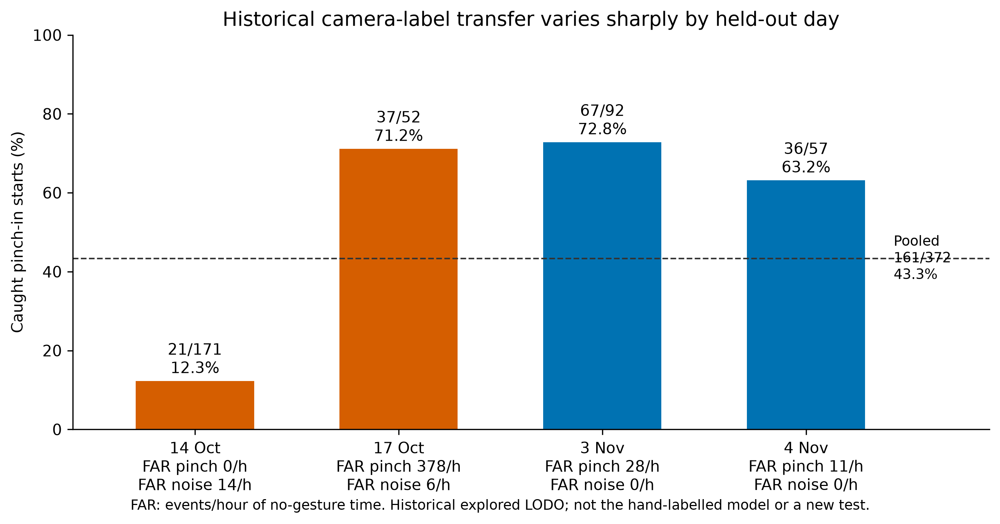
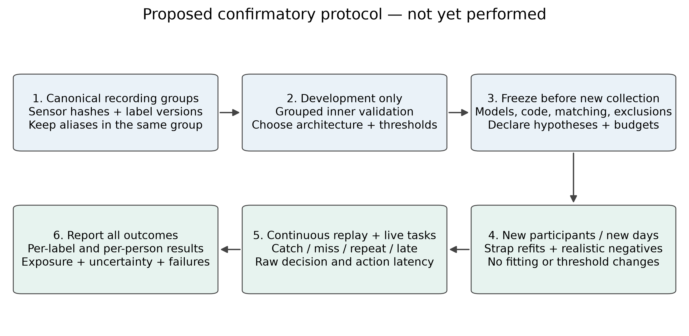

# Springer Nature journal manuscript: detailed Q2-target revision guide

**Applies to:** `main.tex`, `body.tex`, `refs.bib`, `sn-jnl.cls` and the current 17-page PDF. A Springer Nature class is a format, not a Q2 designation. Choose a particular journal, verify its current category/year and author instructions, and adapt the scientific contribution accordingly.

**Companion documents:** [full provenance audit](../EVIDENCE_AUDIT.md), [research plan and primary-source findings](../Q2_RESEARCH_PLAN.md), [IEEE journal section-by-section guide](../ieee-journal/IMPROVEMENTS.md). The two journal body files are currently identical; keep scientific corrections synchronised. This documentation does not silently replace LaTeX or regenerate the original PDFs.

## 1. Main editorial decision

The longer format can support a rigorous systems/measurement study, but length is not evidence. Make the main article about **continuous, failure-aware spatial interaction and reproducible reference labels**, supported by current matched and prospective evaluation. Move broad historical model searches to supplementary information.

The draft's useful engineering—causal clocks, paired release, bounded native output and artifact checking—should answer a measured question. Avoid a paper that reads as an application manual followed by unrelated historical benchmark tables.

## 2. Exact current-data correction

The paper includes October/early-November cue/camera experiments, the November 5 curriculum and the motion-normalisation investigation. It does **not** identify the newer hand-labelled `pinch_in-ae0a22bf` model and its role-specific cohort.

The audit found 37 directories in `Hand labeled`, but nine pairs are identical complete PPG/IMU exports under different names, leaving 28 distinct stream pairs. Fourteen exports contain explicit manual PPG overrides. Thus neither “37 independent sessions” nor “all data manually labelled” is established.

For the hand-labelled pinch-in bundle, 20 training IDs and eight evaluation IDs all resolve, with no identical-stream alias crossing. Its stored event recall is 0.824561 and stored FAR is zero. That is not sufficient to claim a confirmatory test: the bundle lacks full event logs, eligible negative time and latency, and repeated development use has not been ruled out. A training-selected threshold is helpful but does not make all other selection decisions independent.

Older median bundles use unresolved UUID cohorts in this audit. The separately named median pinch-out model must not be silently treated as the matching manually revised pinch-out result.

## 3. Section-level revision specification

### Title and abstract in `main.tex`

Keep the present descriptive title or adopt a measured-systems emphasis. Remove unqualified “two thirds on unseen sessions” and any universal reading of the old PPG-only failure result. State the population, reference-label era and evidence boundary.

Suggested abstract closing, usable without new experiments:

> Historical camera-labelled evaluation showed pronounced cross-day variation, while a later hand-labelled development model is tracked as a separate artifact. These results do not establish population-level or all-day reliability. The system and audit illustrate how annotation provenance, causal temporal scoring and failure-aware control affect the validity of wearable interaction claims, and motivate a frozen prospective evaluation.

Once a new study is complete, replace this with its actual primary outcome and uncertainty. Do not retroactively describe existing exploratory recordings as prospectively collected.

### Introduction and related work

Add explicit hypotheses and a fair related-work matrix. OpenWatch's 50-person multimodal sequence benchmark weakens a generic fusion-novelty claim; ViWatch motivates adaptation distinctions; Tsunoda supports the need for IMU-only and participant/session comparisons. Their recognition accuracy/F1 cannot be used as direct continuous-event baselines without reproducing compatible protocols.

Define the intended mode: personalised or user-independent; quiet/still-hand interaction or moving-hand use. A clear restricted problem is stronger than an unsupported broad claim.

### System design

Include one sensing-to-action architecture and one actual interaction-state diagram/table. Camera landmarks support reference production, not runtime inference. Watch/headphones remain sensor-only; computation and actions remain on the desktop. Link rejection and cancellation transitions to measured fault trials when available, rather than equating a software design with proven physical safety.

### Reference annotations and dataset

Replace “ground truth” language with reference annotations unless contact times have independent validation. Separate three eras: cue, automatic camera, manual override. Explain source-equivalent exports, raw immutability, annotation versioning, exclusions and reviewer uncertainty.

Suggested insertion:

> The original row label and its manual override are retained separately. A nonempty override takes precedence; an empty override preserves the original label, while an explicit no-label marker removes it. Dataset roles are assigned to underlying sensor-stream groups, not filenames. Identical full-stream exports remain in the same group even if they were saved with different gesture names. We report annotation changes and timing uncertainty separately from model gains.

Add a canonical dataset table containing source group, annotation version, participant/day/refit condition, actual sample rates, role, eligible starts, excluded duration and eligible negative exposure. Some fields are currently unavailable; recover them rather than fill them from directory names or PPG-sampled label-run counts.

### Methods

Apply the shared audit's exact equation: decision-level median, `1.4826 × MAD`, channel-dependent floor, clipped sigmoid and final 50 ticks of a 549-tick grid. Distinguish median from rolling variants. The model manifest's prose can be stale even when its preprocessing kind and file hash match; disclose and repair the exporter in a separate change.

Describe the causal first-decline trigger, release threshold, cooldown and timestamps. Report exact training/validation roles, hyperparameter and seed selection, exclusions and operating-point procedure. Do not call nominal 500 ms training delay a measured end-to-end latency.

### Evaluation

Create experiment-specific role/provenance tables. Group identical exports and overlapping source crops; training/evaluation filename disjointness is insufficient. Separate development validation, historical one-shot tests and a new prospective test. State whether any label review or architecture decision used evaluation outcomes.

Use one-to-one continuous event matching; report misses, repeats, late events, negative hours, input availability and emitted-event latency for each direction. Keep window AUC/F1 secondary. Zero observed false events require exposure and an uncertainty bound; a denominator based on total recording duration is not acceptable when gesture, exclusion and unavailable intervals are removed.

### Results

Current order gives substantial space to older robustness screens. Reorganise around the primary questions:

1. Label quality/provenance and annotation disagreement.
2. Current matched modality/baseline/normalisation comparison.
3. Frozen new-person/day/refit generalisation, according to the declared target.
4. Interaction task outcomes and fault/latency behaviour.
5. Brief historical failure analysis, with extended results in supplement.

These are planned sections, **not completed studies**. Before their artifacts exist, preserve a development-study framing and explicitly state what is missing.

Historical corrections required now:

- Selected camera-label LODO is 161/372 = 43.3%, with 7/h noise FAR and 49/h pinch-session negative-time FAR; November subsets alone support roughly two-thirds.
- The 204/372 row includes October data used to train the earlier model; it is not an independent holdout.
- The 15/19 and 10/19 curriculum pair chose thresholds and supplied validation outcomes.
- The motion-burst percentages check a post-start maximum score after synthetic splicing, not live continuous event recall.
- The claimed “final 15/20 and 18/21” needs a verified originating artifact; do not map it to a different model because counts look plausible.

### Discussion and limitations

Explain why improved labels can change the measured score even without changing the model, why paired interaction may have different error consequences for start and release, and why motion-induced normalisation failures require real post-motion tests. Explicitly discuss excluded/failed recordings and available-input coverage.

Suggested paragraph:

> The apparent performance of a detector depends on both its predictions and the reference annotation process. Manual revisions may correct timing or omissions, but without blinded review they may also introduce model-informed selection bias. We therefore distinguish rescoring frozen predictions under revised references from retraining on revised labels. Identical-export grouping addresses one source of leakage; it does not establish independence from repeated development use or guarantee population generalisation.

## 4. Figures and captions

### Add now: real annotation and telemetry


Place in reference annotations. Use this full scientific caption, with exact session identifier available in the artifact:

> Saved PPG and gyroscope samples from one manually revised recording, aligned on watch timestamps. Each optical channel is median-centred and divided by its unscaled MAD over the displayed interval solely for visualisation; gyro magnitude retains rad/s. Original and effective labels are shown separately. No fitted prediction, clock shift or independent physical-contact verification is implied.

```tex
\begin{figure}[t]
  \centering
  \includegraphics[width=\textwidth]{../revision-assets/annotation-telemetry.pdf}
  \caption{Saved telemetry and annotation revision; display-only optical
  median/MAD normalisation, gyroscope magnitude in rad/s. Original and
  effective row labels are separate; this is not model output.}
  \label{fig:annotation-revision}
\end{figure}
```

Use vector PDF for print. Copy the selected file locally before uploading this standalone folder to Overleaf and change the path accordingly.

### Historical result, preferably supplement



Caption it as historical explored camera-label LODO and preserve the day-level rates. It supports a failure analysis, not a claim of the latest model's performance.

### Protocol schematic, planning only



Until executed, include this only under future work or as a clearly proposed protocol. A final completed-study flowchart must match actual cohort roles, exclusions and analysis.

### Outcome graphics still needed

Current-model score/emission timeline; annotation disagreement; per-person/day recall–FAR; paired modality/normalisation effects; real post-motion recovery; task time/error and unintended-action outcomes. The [shared plan](../Q2_RESEARCH_PLAN.md#8-figure-and-table-plan) lists required source artifacts. Do not fabricate representative scores or copy another model's latency distribution.

## 5. Springer Nature declarations and reproducibility

The wrapper currently contains bracketed declarations. Complete them factually:

- Ethics approval/waiver and consent: check institutional and target-journal requirements before recruiting people; do not assert self-recording automatically needs no review.
- Physiological recordings and landmarks: specify consent, access control/de-identification and what can legally/ethically be released. Public code does not imply permission to publish all human data.
- Data/code/model availability: stable repository/version, allowable artifact access, hashes, environment and reproduction commands. State missing artifacts openly.
- Funding, competing interests, author contribution, affiliation and materials: confirm rather than invent.
- Verify all bibliographic placeholders and incomplete author lists; preserve the official `sn-jnl` class rather than editing class internals for cosmetic page reduction.

If selecting an HCI-oriented journal, strengthen interaction comparison and user outcomes; if selecting a sensing/instrumentation journal, emphasise measurement uncertainty, matched modalities and causal deployment performance. Neither scope is served by unrelated drone functionality.

## 6. Completion gate

- [ ] Main results correspond to the current source/annotation/model versions and both targets.
- [ ] New prospective and usability sections are factual, not descriptions of planned experiments in past tense.
- [ ] Historical analyses and limitations remain visible, including poor days and short negative exposure.
- [ ] Body matches IEEE journal counterpart; both abstracts and captions agree with evidence.
- [ ] Declarations, primary references, artifact access and target-venue rules complete.
- [ ] `latexmk -pdf main.tex` passes after actual edits; floats, units, captions and references inspected.
- [ ] Venue-specific quartile and article/extension requirements verified; no Q2 acceptance guarantee claimed.
