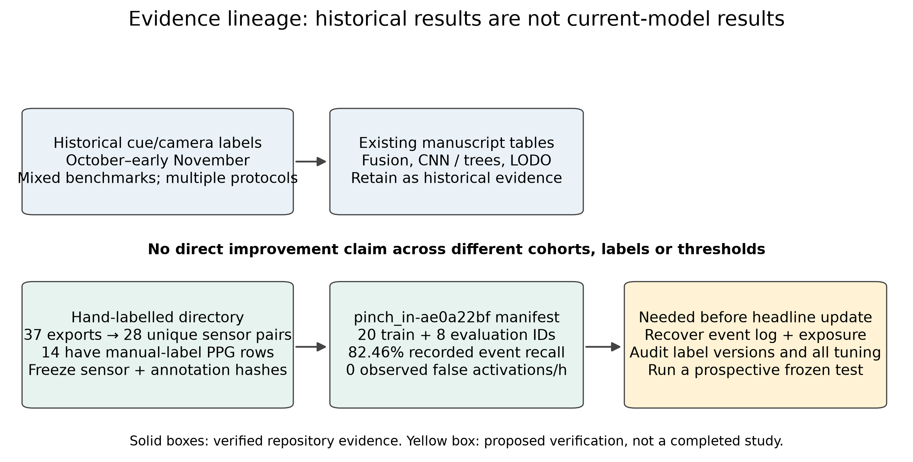

# Springer LNCS conference manuscript: evidence corrections and revision guide

**Applies to:** this folder's `main.tex`, `body.tex`, `refs.bib` and `architecture.png`. The committed PDF is 11 pages. LNCS is a proceedings format, not a journal quartile or an acceptance standard. The actual conference's limits override this observed length.

**Evidence base:** [full audit](../EVIDENCE_AUDIT.md), [Q2 research/study plan](../Q2_RESEARCH_PLAN.md), [IEEE conference editing checklist](../ieee/IMPROVEMENTS.md). This guide adds format-specific revision and proposed text; original manuscript files are unchanged by the documentation audit.

## 1. Scientific changes that must be shared with the IEEE conference version

The conference bodies are currently identical; keep them that way when applying corrections. The abstract in each `main.tex` must be changed separately.

1. **Replace the unqualified two-thirds headline.** Historical camera-label LODO reports 161/372 (43.3%) overall for the selected configuration. Newer-day subsets do better, but that is not a general cross-day result.
2. **Introduce the later annotation era.** The article omits the specific hand-labelled model `pinch_in-ae0a22bf`. Its manifest records 82.46% event recall and zero observed false activations/h on 8 evaluation IDs after training on 20 IDs. These are stored development metrics, not a reproduced prospective test. Do not combine them with historical counts or with the separately stored median pinch-out model.
3. **Group source-equivalent exports.** The manual-data directory has 37 exports but only 28 identical-complete-stream equivalence classes. Nine duplicate pairs must not inflate data size or cross splits. No such crossing was found for the resolved hand-labelled pinch-in roles; other UUID-based cohorts remain unresolved.
4. **Describe effective labels.** Nonempty manual fields override original labels; blank manual fields do not mean negative or reviewed. Only 14 exports have explicit PPG overrides. Report reviewer protocol and unresolved uncertainty.
5. **Correct causality/reproduction details.** Use `1.4826 × MAD + floor`, decision-level history indexing, clipping, causal first-decline event emission and cooldown-from-release semantics.
6. **Demote unmatched claims.** The historical fusion AUC gain and splice-window sensitivity are not measurements of the current manually revised model. Recover the source of “final” 15/20 and 18/21 or delete them.

### Suggested abstract ending

> Continuous evaluation exposed marked day-to-day variation and a mismatch between offline classification scores and dependable command detection. We distinguish historical camera-labelled experiments from a later manually revised development cohort, and report the limits of the available evidence. The system demonstrates the integration of head-directed targeting, desktop pinch inference and bounded wrist control; broader generalisation and usability require a frozen prospective study.

Do not claim that the new prospective study has occurred until its source artifacts exist. After that study, insert its primary event counts and exposure, not an accuracy-only summary.

## 2. Revised section structure

A readable LNCS article can explain the reference-label and causal pipeline better than a cramped two-column paper:

- **Introduction:** target scenario, scope and testable contributions; avoid “first” claims without a comprehensive related-work search.
- **Related work:** separate prompted recognition, continuous detection, adaptation and spatial interaction. Add the comparability table proposed in the shared plan.
- **System:** sensing-to-action topology, head targeting, paired start/release and failures. Keep implementation detail only where it changes safety or latency.
- **Data/reference annotations:** source groups, eras, manual overrides, boundary uncertainty and split roles.
- **Methods/protocol:** causal input construction, detectors, threshold selection and continuous scoring.
- **Results:** current matched experiment first, historical evidence clearly separated; per-day/person outcomes and both directions.
- **Discussion/limitations:** single participant, drift/refits, weak older-day transfer, exclusion bias, limited negative exposure and physical validation gaps.

Until new results exist, retain an honest development-study framing rather than writing “current matched experiment” as if completed.

## 3. Images and placement

### Reference annotation figure


Place after the reference-annotation subsection. Use a full-text-width `figure`, not an IEEE-style `figure*`, because LNCS is single column.

```tex
\begin{figure}[t]
  \centering
  \includegraphics[width=\textwidth]{../revision-assets/annotation-telemetry.pdf}
  \caption{Saved telemetry and original/effective row annotations for one
  manually revised recording. PPG channels use displayed-window median/MAD
  scaling only for visibility; gyroscope magnitude is in rad/s. This is not
  detector output or independently verified physical contact timing.}
  \label{fig:annotation-revision}
\end{figure}
```

Use the full session/clock/normalisation provenance from [the audit](../EVIDENCE_AUDIT.md). Keep text readable after scaling and do not reduce captions to hide required evidence qualifications. For standalone Overleaf uploads, copy the selected PDF into this folder and adjust the path.

### Historical day-transfer figure


Place with the historical LODO result if retained. It documents 21/171, 37/52, 67/92 and 36/57 catches, with distinct pinch/noise FAR values. It is not a comparison of the current manual-label model with older models.

### Source-role schematic



The schematic is useful for revision review or supplementary material. For the final paper, consider replacing it with a compact dataset-role table to avoid spending a page explaining editorial history. The future-confirmatory box must remain visibly proposed.

## 4. Text to add

### Source grouping and cohort policy

> A recording is identified by its underlying sensor stream rather than its export filename. We retain original sensor timestamps and track annotation changes separately. Identical complete PPG/IMU exports share a source group and cannot be assigned independently to development and evaluation. Historical cue/camera-labelled studies and later manually revised recordings are described as separate cohorts; they are not pooled into a single claim of generalisation.

### Evidence qualification

> The hand-labelled pinch-in model has disjoint training and evaluation IDs and a training-selected threshold according to its manifest. However, a disjoint list alone does not establish that the evaluation data were untouched by annotation, architecture or repeated model selection. Without its complete event log and eligible negative exposure, the stored metric is development evidence and cannot establish an all-day false-activation rate.

### Limitations paragraph

> The data originate primarily from one participant, and the historical results vary sharply across recording days. Manual review improves traceability but does not remove camera mapping error or establish physical contact time. Reported false-activation rates are conditional on recorded activities, available inputs and declared exclusions. A prospective multi-day study and a controlled interaction task are needed before making broader reliability or usability claims.

## 5. What more to do for the journal-level research goal

Follow the [shared plan](../Q2_RESEARCH_PLAN.md), prioritising:

- Reviewer-audited boundaries and paired old-versus-reviewed annotation analysis.
- Matched IMU-only, PPG-only and fused models using the same source-group splits, budget and operating-point policy.
- Median versus rolling normalisation on real post-motion activity, separate from synthetic splice window scores.
- A frozen prospective evaluation across declared participant/day/refit conditions, with per-target counts, uncertainty, negative exposure and input availability.
- Counterbalanced target-volume tasks, unintended-action measurement and physical fault/reconnect trials.

No need to add a larger architecture or unrelated drone work. A later journal article needs material scientific evidence beyond the proceedings version, with the earlier paper cited and extension/duplicate-publication policy checked.

## 6. LNCS-specific checks

- [ ] Actual conference page/reference limits and anonymisation rules verified.
- [ ] Shared scientific body stays identical to the IEEE conference variant.
- [ ] `splncs04` bibliography entries contain complete, authoritative metadata; placeholders removed.
- [ ] Figures use readable single-column widths, consistent labels and declared units/normalisation.
- [ ] Affiliation, ethics/consent and data/code availability are factual and complete.
- [ ] Build with `latexmk -pdf main.tex` after substantive edits; inspect floats and cross-references.
