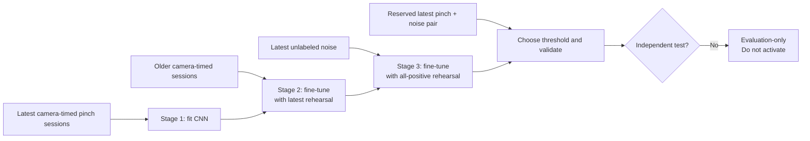

# CNN curriculum: newest clean data, older camera labels, then noise

**Status:** exploratory validation only; not eligible for import or activation.

This record captures two GPU experiments performed on 5 November 2026. The goal was to test whether ordering the data could improve a separate `pinch_in`/`pinch_out` CNN: learn the newest camera-timed pinch labels first, introduce older camera-timed labels, then teach everyday noise.

## Workflow

Noise was never used alone for a fine-tuning stage: a binary model trained only on `not pinch` examples would be driven toward predicting no pinch everywhere. Each later stage replays all earlier clean positive recordings to limit catastrophic forgetting.

## Data policy and split

| Role | Recordings | Use |
|---|---:|---|
| Latest clean | 7 camera-timed 3/4 Nov sessions | Stage 1; rehearsed in stages 2–3 |
| Older clean | 14 camera-timed 14/17 Oct sessions | Added in stage 2; rehearsed in stage 3 |
| Latest noise | 6 unlabeled 4 Nov sessions | Added in stage 3 |
| Reserved validation | 1 camera-timed pinch session and 1 unlabeled-noise session from 4 Nov | Threshold selection and reported validation |

All fist sessions were excluded. Older non-camera labels were excluded rather than treated as reliable supervised targets. No raw recording was deleted. The machine-readable result artifact marks every recording ID by role, the held-out pair, and the cumulative stage order: [`cnn-curriculum-old-noise-2026-11-results.json`](artifacts/cnn-curriculum-old-noise-2026-11-results.json).

The CNN remained the existing 9-channel, 1-second, three-member model: accelerometer, gyroscope, and RGB PPG at 50 Hz, each channel normalized against its previous 10 seconds. Each stage used 12 epochs, Adam (`0.001`), weight decay (`0.0001`), and the GPU-enabled `gesture-ml-trainer` container on the GTX 1050 Ti.

## Preliminary experiment: newest clean data, then noise, tested on old camera data

Before the full curriculum, a narrower transfer test trained on newest clean recordings, then fine-tuned with latest noise plus clean-positive rehearsal. Thresholds were selected using a small reserved latest validation pair; older 14/17 Oct camera-timed recordings were never used in this experiment's training.

| Target | Stage | Older-camera recall | Older-camera false activations/hour | Interpretation |
|---|---|---:|---:|---|
| `pinch_in` | clean only | 70/223 (31.4%) | 232.5 | New-only model did not transfer safely to October |
| `pinch_in` | then noise | 22/223 (9.9%) | 12.9 | Noise suppressed false alarms but also suppressed most old pinches |
| `pinch_out` | clean only | 11/225 (4.9%) | 15.4 | Very low transfer recall |
| `pinch_out` | then noise | 22/225 (9.8%) | 38.4 | Still low recall and now over the 30/hour budget |

This falsified the idea that newest clean data plus noise alone is enough to generalize backwards to the October signal domain.

## Full curriculum result

The follow-up trained the sequence shown above. Both CNNs used a threshold of `0.99`, chosen on the reserved latest pair.

| Target | Caught / labelled starts | Recall | False activations/hour | Median latency |
|---|---:|---:|---:|---:|
| `pinch_in` | 15/19 | 78.9% | 0.0 | 469 ms |
| `pinch_out` | 10/19 | 52.6% | 0.0 | 390 ms |

Artifacts were validated as `ppg-imu-cnn` version 1 JSON and their SHA-256 values were checked after retrieval:

| Target | SHA-256 |
|---|---|
| `pinch_in` | `921ec67e87903e6baeb79138416bad8178822cb58b0ea01e58a7ac92271dcbde` |
| `pinch_out` | `c7a18dcf057a2953c04a37ff129b014a5911bc334a77a21646e68c21d04a768d` |

Raw outcome fields and cohort identifiers are preserved in [`cnn-curriculum-old-noise-2026-11-results.json`](artifacts/cnn-curriculum-old-noise-2026-11-results.json).

## Analysis

The result is promising for `pinch_in`: adding the older camera-timed domain before noise recovered performance that the newest-only transfer experiment did not have. It supports retaining old camera-timed recordings rather than assuming only the newest recordings are useful.

It does **not** establish live readiness:

- The same two reserved recordings selected the threshold and supplied the displayed validation metric. This is validation, not an untouched test.
- Nineteen starts and roughly 400 seconds of negative time are too little evidence for an everyday false-activation claim.
- `pinch_out` recall remains only 52.6%, below an acceptable everyday detector level.
- The curriculum changes data order, not the underlying sensor coverage. Moving-hand pinches, new watch placements, and longer ordinary-activity recordings remain underrepresented.

## Next test after new data arrives

Freeze this curriculum, its architecture, and thresholds before collecting the test set. Add new camera-timed sessions across days, watch fit/orientation, activity, and both pinch directions; add independent ordinary-activity noise sessions. Hold out entire new sessions that no training or threshold-selection stage sees, then replay them continuously and report event recall, false activations/hour, latency, and repeats separately for `pinch_in` and `pinch_out`.

Only consider activation if both directions meet the false-activation budget on those untouched sessions and the recall target is agreed before inspection.
