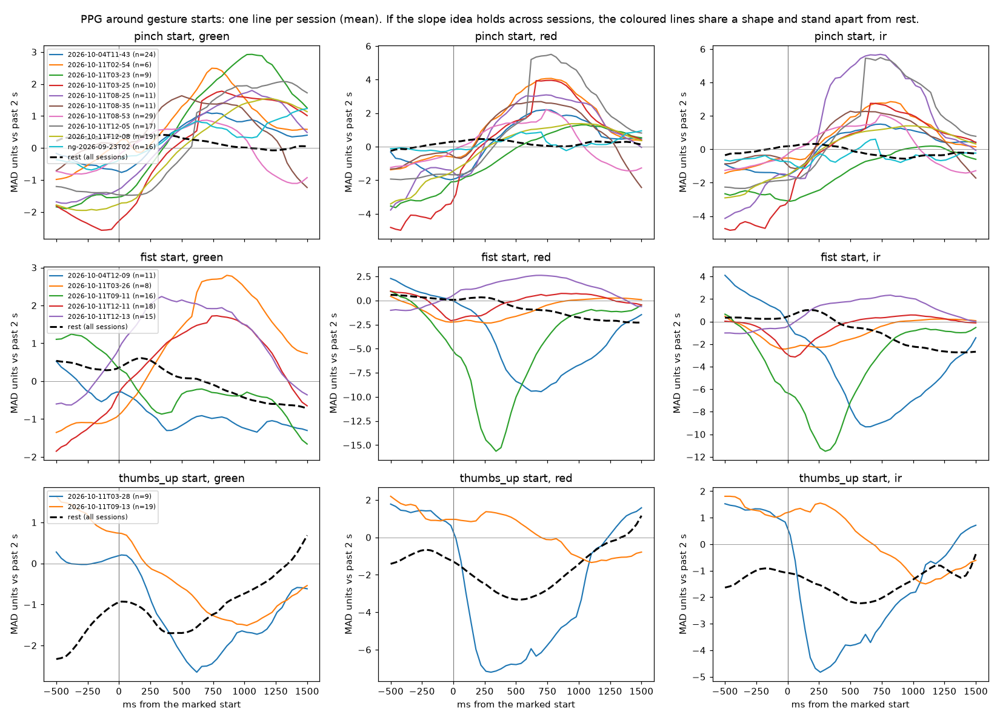
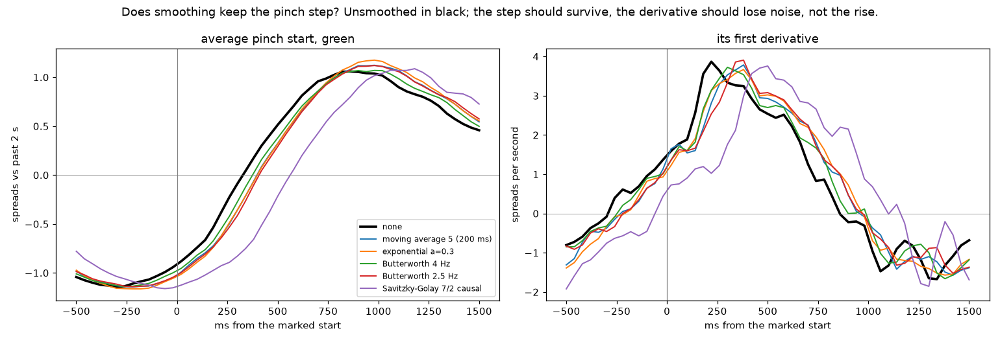

# PPG step across a gesture: findings, October 2026

**Question.** Does the PPG signal around a gesture have a slope or shape that is the same from one recording session to
the next, so that a model trained on some sessions works on a new one? The motivating use case is PPG-only gesture
recognition for gestures where the arm also moves, so that motion features cannot be relied on.

**Short answer.** For pinch, yes: in units of each session's own recent past, the PPG *steps up* across the start of a
pinch in every pinch session, on all three channels, and a rule on that step tells pinch starts from other moments in
sessions it never saw. **Those other moments were mostly the middle of a held pinch, not rest** (see the correction
below): against rest there is too little clean data to say. Fist is not consistent between sessions. Thumbs-up dips, but
only two sessions exist. The step is now a feature in the trainer and the live runtime (`ppg_{green,red,ir}_rel_z_step`).
It marks the *start* of a gesture, so getting full value from it needs a "gesture just started" training target, which
does not exist yet.

## Correction (2026-10-13): the "rest" controls were mostly inside gestures

The label audit in [ppg-rgb-onset-follow-up-2026-10.md](ppg-rgb-onset-follow-up-2026-10.md) found that generated rest
windows overlapped recorded pinch holds. The same flaw is in this study. Every script below picked "rest" moments as
anything at least 1.5 s from a gesture's start or end, without checking that the moment lay outside a gesture, so the
middle of any hold longer than 3 s qualified. Rechecked ([scripts/recheck_rest_controls.py](ppg-step-study/scripts/recheck_rest_controls.py)):

- **84% of the candidate "rest" moments were inside a gesture** (1,645 of 1,958, all gestures).
- **Pinch start vs the middle of a held pinch:** the step separates them very well. Median AUC 0.94, worst 0.73, over 7
  sessions; mid-hold moments have no step (green median +0.02, half rising).
- **Pinch start vs true rest** (time with no gesture marked): only 23 such moments, in 2 sessions. A median of 0.72
  (worst 0.56) cannot support any claim.
- **Unmarked time is not clean rest anyway.** The audit found every "rest" row is a blank label, not an explicit
  non-pinch mark.

So read every "rest" below as **"not a pinch start, mostly mid-hold"**. The step is a sound *onset* signal: it tells the
start of a pinch from the rest of that pinch. Whether it tells a pinch start from ordinary non-pinch activity is
**untested**, and needs recordings with explicitly labelled rest and non-pinch movement. The tables are kept as measured,
because they are still what these comparisons produced.

Related: [slope-morphology-event-detection.md](slope-morphology-event-detection.md) (the research behind the idea) and
[../architecture/ppg-slope-event-technique.md](../architecture/ppg-slope-event-technique.md) (the technique and what is
built). Scripts, the figure and raw output: [ppg-step-study/](ppg-step-study/).

## Data

The `gesture-dataset-*.csv` recordings exported between 2026-09-22 and 2026-10-11 (now in `data/recordings/2026-10-downloads/`,
listed in `data/recordings.manifest.json`), one wearer, one watch.

| Used | Sessions | Days | Gesture starts (after merging) |
|---|---|---|---|
| pinch (including the one named `pinching`) | 10 | 2026-09-23, 10-04, 10-11 | most of the 248 below |
| fist | 5 | 10-04, 10-11 | |
| thumbs-up | 2 | 10-11 | |

248 marked gesture starts and 178 rest moments in total (green channel).

Left out:

- `pinch-2026-09-22`: its timestamps span 5 million seconds, so they cannot be placed in time.
- Recordings with no marks at all (two `unlabeled`, three `pinch` from 10-10 and 10-11), and `pinch_open` (two) and the
  single twist recording, as earlier agreed: unmarked recordings are skipped, gaps between marks are rest.

How the data was read:

- Through the trainer's own reader (`csv_io.load_recording`) and its millisecond-timestamp repair. Blank labels were
  filled with `rest` in a temporary copy.
- PPG arrives at 25.0 Hz in every usable session, so durations come in steps of about 40 ms.
- The marks flicker for a row or two around each change, so marked stretches were merged across gaps of under 400 ms, and
  stretches shorter than 200 ms were dropped.

## Method

**Normalisation (causal, per sample).** Each PPG sample minus the median of the 2 s before it, divided by those 2 s'
spread (median absolute deviation × 1.4826). This cancels the session's arbitrary level (sessions sit hundreds of
thousands of counts apart) and how far the signal swings, which depends on how the watch sits. Units below are "spreads".

**Event-locked view.** Every marked gesture start, and random "rest" moments at least 1.5 s from any start or end, is a
moment. (Not checked to lie outside a gesture: 84% were mid-gesture; see the correction above.) The normalised signal is taken from 500 ms before each moment to 1500 ms after it.

**The step.** The mean of the normalised signal from 400 to 900 ms after the moment, less the mean from 400 to 100 ms
before it. This is the "after minus before" form of the slope idea.

**Judging.** AUC: 0.5 means no difference, 1.0 perfect, below 0.5 the opposite direction. Unseen-session results train on
every other session and test on the one left out.

## Findings

### 1. The first measurement, the largest excursion, was the wrong one

The first pass measured each moment by its largest excursion after the start against the previous 2 s: prominence,
onset-to-peak, rise slope and so on. It looked like failure:

- Start vs rest on unseen sessions: AUC 0.50 to 0.57 on green only, and 0.64 to 0.67 on all channels.
- Pinch vs fist with a whole day held out: 0.60.
- Per-session AUCs scattered around 0.5.

The averaged waveforms (finding 2) showed why. A pinch is a *step* that begins slightly below the baseline, so "largest
excursion" often picked the wrong extreme. Raw numbers: [ppg-step-study/scripts/study-report.txt](ppg-step-study/scripts/study-report.txt).

**Lesson:** for this signal, the change across the start is the feature, not the peak against a baseline.

### 2. The averaged shape: consistent for pinch, not for fist



One line per session (the mean over its starts), with rest as the black dashed line.

- **Pinch:** every one of the 10 sessions rises through the start on green, red and infrared, from about −1.5 to +2–3
  spreads over 0–750 ms. Rest stays flat near 0.
- **Fist:** sessions disagree. Green rises in three sessions and falls in two. Red and infrared dip deeply (−10 to −15) in
  two sessions and are flat or rising in the others.
- **Thumbs-up:** both sessions dip.

### 3. The step, event by event

Only sessions with at least 5 rest moments could be judged (6 of 10 pinch, 4 of 5 fist, 2 of 2 thumbs-up).

| Gesture | Channel | Sessions stepping up | Share of single events rising, per session | Median AUC vs rest |
|---|---|---|---|---|
| pinch | green | 6/6 | 69–100% | 0.84 |
| pinch | red | 6/6 | 56–100% | 0.88 |
| pinch | infrared | 5/6 | 44–100% | 0.85 |
| fist | green | 2/4 | 19–100% | 0.61 |
| fist | red | 2/4 | 0–87% | 0.49 |
| thumbs-up | green | 0/2 (dips) | 11–16% | 0.09, meaning a strong dip |

The weakest pinch session is `pinching-2026-09-23`, the oldest, recorded with an earlier watch build. Its red and infrared
barely step (median +0.05 and −0.40).

Fist flips between sessions on the same day: 09:11 dips and 12:11 rises. A change in how the strap sat is the most likely
explanation; it has not been tested.

### 4. One rule on unseen sessions (pinch)

A logistic regression on the three channels' steps, trained on all the other pinch sessions and tested on the one left
out, pinch start vs rest:

| Held-out session | AUC |
|---|---|
| pinch 2026-10-04 11:43 | 0.80 |
| pinch 2026-10-11 02:54 | 0.93 |
| pinch 2026-10-11 03:23 | 1.00 |
| pinch 2026-10-11 03:25 | 1.00 |
| pinch 2026-10-11 08:25 | 0.90 |
| pinch 2026-10-11 08:35 | 0.76 |
| pinch 2026-10-11 08:53 | 0.81 |
| pinch 2026-10-11 12:05 | 0.89 |
| pinch 2026-10-11 12:08 | 0.98 |
| pinching 2026-09-23 02:26 | 0.72 |

Median **0.90**, worst 0.72, best 1.00.

### 5. Against raw PPG, on the same events

Same pinch events, same rest moments, each session held out in turn. Only moments with 2.5 s of signal before and 1.5 s
after were used, for every feature set (145 starts, 95 rest moments, 8 sessions with both).

| Features | Logistic regression: median AUC (worst) | Boosted trees: median AUC (worst) |
|---|---|---|
| Raw PPG level after the start | 0.52 (0.00) | 0.60 (0.38) |
| Raw PPG step, in counts | 0.84 (0.24) | 0.75 (0.36) |
| Normalised step | **0.86** (0.37) | **0.83** (0.24) |

- **Raw levels are at chance on new sessions.** A model on raw values learns the session, not the gesture.
- **The change over time is what transfers.** Most of the gain comes from the step itself; normalising by the session's
  own spread adds a little and puts every session on one scale.
- **Treat these as ±0.05.** With about 95 rest moments, another random draw of rest moments moves results by that much,
  which is why finding 4 shows 0.90 and this table 0.86. An earlier run that also included starts without 2 s of history
  gave the normalised step 0.79/0.70: an artefact of zeroed values, not a property of the feature.
- **Some held-out sessions still fail** (worst 0.24–0.37).

### 6. In the trainer's own pipeline

After the step was implemented (finding 7), it was checked with the trainer's windows and features: PPG only, a 2000 ms
baseline, each recording scored by a model trained on all the others (`research.leave_one_recording_out`). The target was
pinch against rest, fist and thumbs-up. Pooled AUC is over every recording's windows together; median and worst are per
recording.

**"Is a pinch held now?"** This is how the trainer labels today: every window inside a mark is positive. 1300 ms windows,
6 recordings judged:

| Features | Logistic regression: pooled / median / worst | Boosted trees: pooled / median / worst |
|---|---|---|
| PPG window statistics | 0.32 / 0.79 / 0.34 | 0.58 / 0.78 / 0.51 |
| + `rel_z` (previous best) | 0.39 / 0.74 / 0.51 | 0.57 / 0.82 / 0.46 |
| + `rel_z` + step | 0.39 / 0.74 / 0.50 | 0.57 / 0.79 / 0.68 |
| step only | 0.57 / 0.70 / 0.50 | 0.62 / 0.63 / 0.52 |

With 500 ms windows (10 recordings judged), the step lifted the boosted trees' worst recording from 0.65 to 0.71 and the
median from 0.75 to 0.78. Otherwise it added little. The middle of a held pinch has no step left in it.

**"Did a pinch just start?"** A window is positive when a pinch began within 10–60% of it, and negative when no gesture
began or ended within 1 s of it. That left windows in the middle of long holds among the negatives, contrary to what this
note first said (see the correction above). 1300 ms windows, 536 start and 477 other windows, 6 recordings judged:

| Features | Logistic regression: pooled / median / worst | Boosted trees: pooled / median / worst |
|---|---|---|
| PPG window statistics | 0.28 / 0.65 / 0.41 | 0.49 / 0.87 / 0.59 |
| + `rel_z` (previous best) | 0.36 / 0.72 / 0.55 | 0.50 / 0.84 / 0.58 |
| + `rel_z` + step | 0.36 / 0.73 / 0.54 | 0.53 / 0.81 / 0.53 |
| step only | **0.68** / 0.77 / 0.34 | **0.70** / 0.76 / 0.53 |

The key result is the gap between pooled and per-recording scores:

- **Existing PPG features** rank windows well *inside* a recording (median 0.81–0.87), but pooled across recordings they
  drop to 0.3–0.5. Their scores mean different things in different sessions, so no single live threshold works for all
  of them.
- **The step alone** pools at 0.68–0.70, close to its per-recording median. Its scale carries over between sessions,
  which is exactly the property the question was about.

### 7. What was built

Stage 1 of the [technique](../architecture/ppg-slope-event-technique.md), on branch `feat/ppg-step-features` (commit
`5b10058`):

- **The feature:** for each channel, `ppg_*_rel_z_step` is the window's PPG through `pulse_z` against the baseline before
  the window, then the mean over the window's last 40% less the mean over its first 25%. With a 1.3 s window that matches
  the spans tested above.
- **Same numbers in training and live:** `features.py` (`baseline_step_features`) and `crates/pinch-inference/src/features.rs`
  compute it identically, pinned by new cases in `tests/fixtures/baseline_cases.json`. Existing expected values were
  unchanged.
- **Old models keep working:** the features are added after every existing one (feature count 107 → 110), so existing
  models' inputs stay in place. They are opt-in with the other baseline features, and Model Lab describes them.

### 8. Smoothing keeps the features, if it is mild and causal

The research document's process is to smooth before differentiating, using only causal smoothing for anything live. Ten
smoothers were run over the raw PPG of the same sessions ([scripts/smoothing_check.py](ppg-step-study/scripts/smoothing_check.py)).
For each, three things were checked against no smoothing:

- **The step:** its size, the share of pinches that rise, and the unseen-session rule from finding 4 (8 pinch sessions
  judged).
- **The steepest rise:** the largest first derivative in the 900 ms after the start. How well it tells gesture starts from
  rest, and how much of it is kept.
- **Lag:** when the steepest rise happens, compared with a zero-phase filter (the "true" timing; offline only).

| Smoother | Step kept | Pinches rising | Unseen-session AUC (worst) | Steepest-rise AUC | Steepest rise kept | Lag |
|---|---|---|---|---|---|---|
| none | 100% | 87% | 0.83 (0.51) | 0.65 | 100% | 0 ms |
| moving average, 3 samples (120 ms) | 100% | 86% | 0.82 (0.52) | 0.65 | 96% | +40 ms |
| moving average, 5 samples (200 ms) | 99% | 86% | 0.82 (0.55) | 0.65 | 91% | +80 ms |
| moving average, 7 samples (280 ms) | 97% | 86% | 0.79 (0.55) | 0.65 | 86% | +120 ms |
| exponential, a = 0.5 | 100% | 87% | 0.82 (0.53) | 0.63 | 92% | 0 ms |
| exponential, a = 0.3 | 97% | 86% | 0.81 (0.49) | 0.64 | 84% | +40 ms |
| Butterworth low-pass, 2nd order, 6 Hz | 100% | 87% | 0.82 (0.52) | 0.64 | 98% | 0 ms |
| **Butterworth low-pass, 2nd order, 4 Hz** | **100%** | **87%** | **0.82 (0.55)** | **0.65** | **97%** | **+40 ms** |
| Butterworth low-pass, 2nd order, 2.5 Hz | 99% | 86% | 0.82 (0.56) | 0.65 | 92% | +80 ms |
| Savitzky-Golay, 7 samples, quadratic, causal | 82% | 83% | 0.74 (0.54) | 0.66 | 105% | +200 ms |



- **Mild causal smoothing keeps the step.** Moving averages up to 5 samples, exponential smoothing and Butterworth
  low-pass filters from 2.5 to 6 Hz keep 97–100% of it, the same share of rising pinches and the same unseen-session
  score. The gesture lives below about 3 Hz (a 300–750 ms rise), so filters above that leave it alone. The step feature
  averages over 300–500 ms stretches, so it barely needs smoothing at all.
- **The cost is delay.** Each causal smoother delays the rise by 0–120 ms, more for stronger smoothing. At 25 Hz,
  40 ms is one sample.
- **Causal Savitzky–Golay is the one to avoid.** Estimating the newest sample from the past 7 extrapolates a polynomial
  forward: it overshoots (105% of the slope), lags 200 ms, keeps only 82% of the step, and its unseen-session score drops
  to 0.74.
- **Smoothing did not make the slope more telling.** The steepest-rise score stays at 0.63–0.66 with or without
  smoothing. Once slopes are taken on an even grid (next point), the derivative at 25 Hz is not dominated by sample noise,
  so smoothing buys smoother curves, not more signal.
- **The PPG timestamps jitter.** In every session 6–10% of the gaps between samples exceed 60 ms, and 0.1–6.7% are under
  5 ms (a late sample followed closely by the next). A derivative over consecutive raw timestamps divides by those
  near-zero gaps and explodes. Slopes have to be taken on an evenly resampled 25 Hz grid, or over at least two sample
  periods, never sample to sample. This applies to the live tracker too.

**Choice for the tracker:** a 2nd-order causal Butterworth low-pass at 4 Hz on the 25 Hz grid. It keeps 100% of the step
and 97% of the steepest rise for 40 ms of delay. A 3-sample moving average is a simpler alternative with the same delay.

## Earlier experiments in the same line of work (2026-10-11 and 10-12)

These were run with other set-ups and are listed for context, not compared directly with the tables above.

- **PPG as an image** (the "plot it and use a CNN" idea), any gesture vs rest, 6 folds by recording:

  | Representation | AUC |
  |---|---|
  | 1-D signal against its own past | 0.79 |
  | Line plot, fixed axes | 0.73 |
  | Gramian angular field | 0.72 |
  | Min-max per window | 0.65 |
  | Auto-scaled line plot | 0.65 |

  For pinch vs fist: 0.77, 0.70, 0.59, 0.70 and 0.67 in the same order. Turning the signal into an image did not beat
  using the signal directly.
- **Method comparison** on held-out recordings. Motion plus pulse caught more gestures than motion alone for every method,
  at a lower false-alarm rate:

  | Method | Gestures caught: motion / motion + pulse | False-alarm rate: motion / motion + pulse |
  |---|---|---|
  | MLP | 24 / 37 of 73 | 0.21 / 0.17 |
  | 1-D CNN | 15 / 21 | 0.28 / 0.17 |
  | Boosted trees | 16 / 21 | 0.11 / 0.05 |

  Logistic regression caught 7 and then 10, but was weak on both (test AUC 0.52–0.53).

## Data-collection findings that bear on this work

Found while chasing a broken PPG stream and a lagging graph. Fixed on `main`, but they shape what older data can be
trusted for:

- **Older recordings have unreliable PPG timing.** Samsung's SDK gives PPG timestamps in milliseconds, and the app treated
  them as nanoseconds until the fix of 2026-10-11 (on `main` in `a269f59`). The trainer repairs this, but `pinch-2026-09-22` cannot be repaired and
  was excluded above.
- **PPG over Bluetooth was silently lost** whenever the link reached 517-byte packets: 514-byte fragments were refused
  (the attribute limit is 512) and the watch emptied its queue without a log line. Wi-Fi was unaffected. Any Bluetooth
  session recorded at that packet size before the fix has no PPG.
- **At a 1 Hz PPG flush each batch is about 25 samples**, and live delivery adds up to a second of delay. The default is
  now 10 Hz: 2–3 samples a batch. Since 2026-10-13 motion and pulse travel as separate streams, each batched at its own
  pace.
- **Sudden arm movements can starve the Bluetooth link.** The watch now drops its oldest unsent messages after about half
  a second instead of queueing seconds of data, so a recording may contain short gaps where it used to contain long
  delays.

The whole investigation is in [watch-data-path-findings-2026-10.md](watch-data-path-findings-2026-10.md).

## Limits

- **One wearer, one watch, few sessions.** Only 6 to 8 sessions had enough rest moments to be judged in the stricter
  tests. Per-session results swing by ±0.05 with a different draw of rest moments.
- **Known boundaries.** Findings 3 to 5 used the marked start times. Whether a live detector can *find* these steps
  without false alarms (Phase B in the research document) is untested.
- **Motion was not separated.** Part of the step may be the arm's movement appearing in the PPG rather than pressure.
  This matters for the PPG-only goal and is the next check: compare against the motion sensors over the same moments.
- **Mark timing.** Camera and manual marks lag or lead the real start by up to a few hundred milliseconds; the
  400–900 ms window absorbs most of that.
- **Latency.** The step needs about 0.9 s after the start, so a live decision comes roughly a second after a pinch begins.

## Next steps, in order

1. **A "gesture just started" training target** (a trainer option, chosen in Model Lab): positives are windows where the
   gesture begins, and windows inside a hold are left out. It goes with one-shot scoring live; the app already has
   one-shot recipe steps.
2. **Recordings with rest between gestures**: pauses of 1–2 s between pinches. Only 6 of 17 recordings had enough quiet
   time for the "just started" test.
3. **The motion control check** (see Limits).
4. **Fist on purpose**: several sessions with the strap deliberately tighter and looser, to see whether the flip follows
   the fit.
5. **Only then the causal event tracker** of the technique document, if stage 1 falls short.

## Reproducing

From `tools/label-trainer` (`matplotlib` is only needed for the figure and is not a trainer dependency):

```bash
uv run --with matplotlib python -I ../../docs/research/ppg-step-study/scripts/study.py ../../docs/research/ppg-step-study/scripts /tmp/ppg-study
uv run --with matplotlib python -I ../../docs/research/ppg-step-study/scripts/step.py ../../docs/research/ppg-step-study/scripts /tmp/ppg-study
uv run --with matplotlib python -I ../../docs/research/ppg-step-study/scripts/compare_raw.py ../../docs/research/ppg-step-study/scripts /tmp/ppg-study
uv run --with matplotlib python -I ../../docs/research/ppg-step-study/scripts/trainer_eval.py ../../docs/research/ppg-step-study/scripts
uv run --with matplotlib python -I ../../docs/research/ppg-step-study/scripts/onset_eval.py ../../docs/research/ppg-step-study/scripts /tmp/ppg-study
uv run --with matplotlib python -I ../../docs/research/ppg-step-study/scripts/smoothing_check.py ../../docs/research/ppg-step-study/scripts /tmp/ppg-study
```

The recordings are in `data/recordings/2026-10-downloads/`. `data/recordings.manifest.json` lists every file with its size,
SHA-256, labels and whether this study used it, and `python3 scripts/recordings_manifest.py check` confirms they are
unchanged. The scripts fall back to `~/Downloads` when the repo copy is absent (see `load.py`). Rest moments are
drawn with a fixed seed, so a rerun on the same files gives the same numbers.
